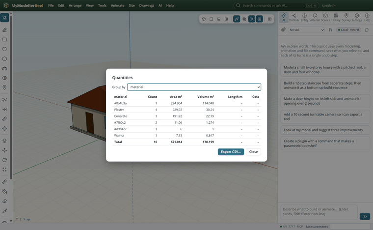
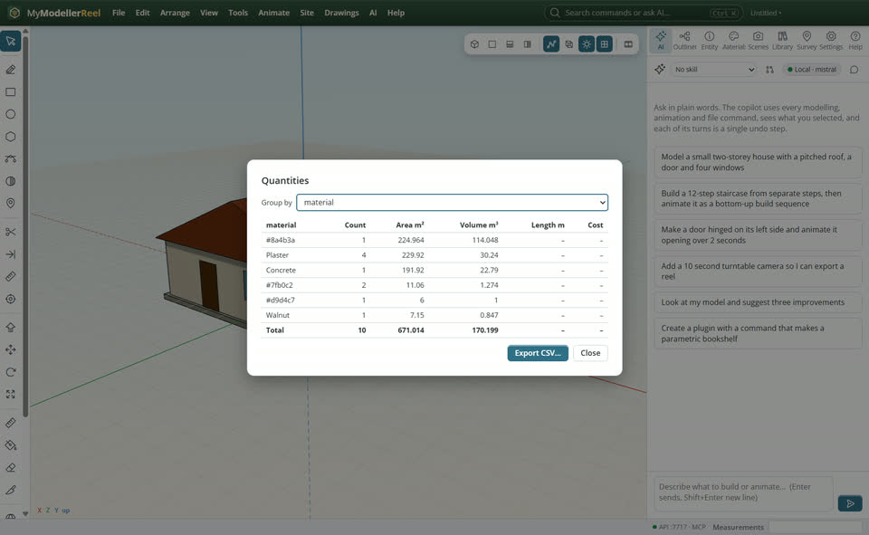
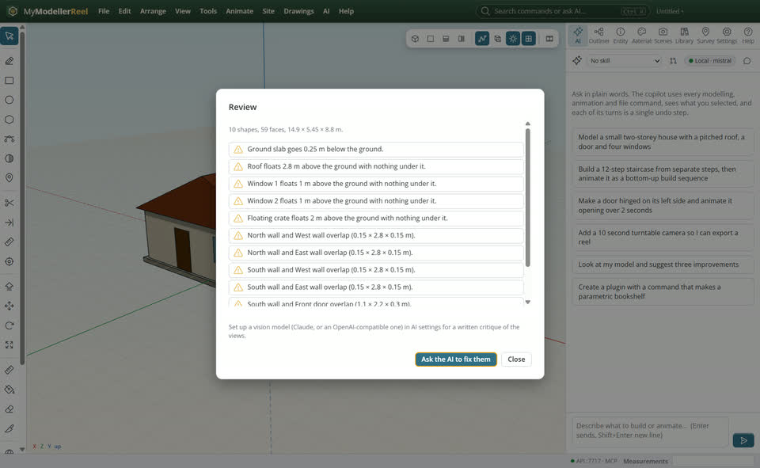

# Check a model and count what is in it

Before you share a model: is anything floating or colliding, are the sizes sensible, and how much of each material is there?



## In the app

1. **File › Quantities** [Quantities](action:quantities): count, area, volume, length and cost per material, layer or data value; save as CSV.
   
2. **AI › Review my model** [Review](action:review): floating parts, collisions, parts below the ground, unlikely sizes; with a vision model it also critiques four views.
   

## Ask the copilot

> Review my model and fix what you find, then give me the quantities by layer.

The copilot runs the same commands as the steps above; with **AI › Propose AI changes for review** on, you accept or reject its changes first.

## From a script, the HTTP API or MCP

```js
await api.review_model({});
await api.report_quantities({ group_by: 'tag', path: 'C:/reports/quantities.csv' });
await api.model_info({});
await api.purge({});
```

## Good to know

- **Edit › Model info** and **Edit › Purge unused** keep files lean.

## Related

- [Ask the copilot to build or change something](howto:ask-the-copilot)
