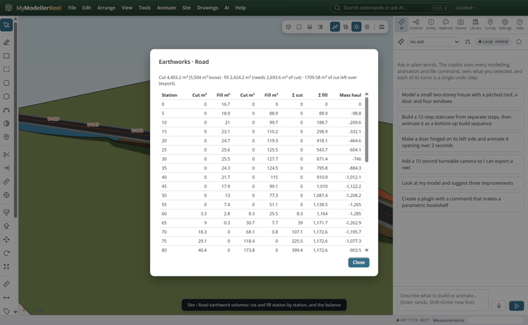
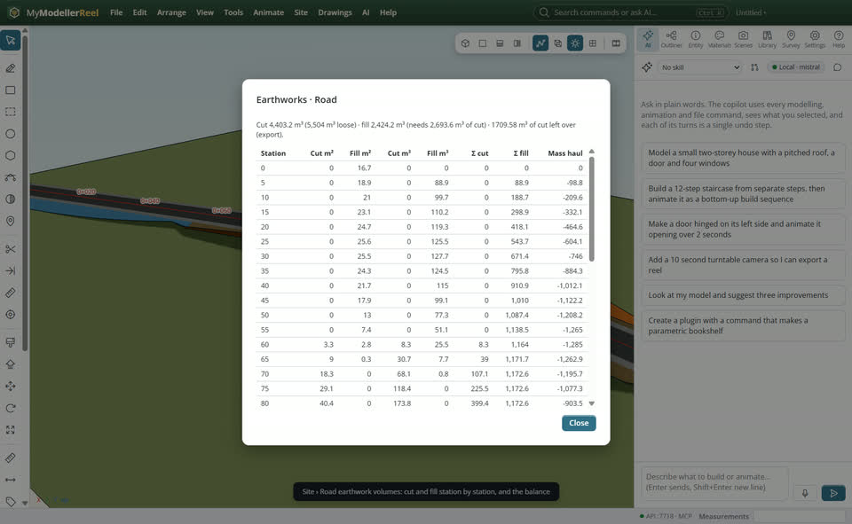
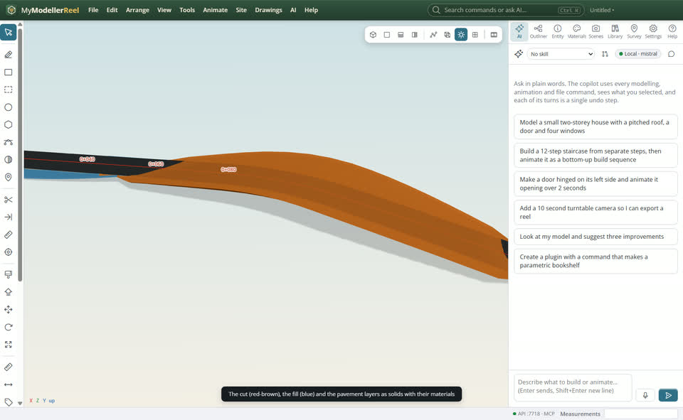
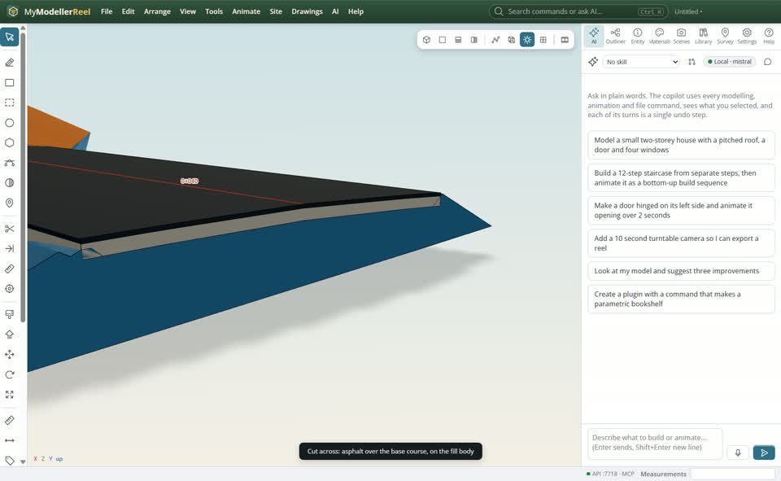
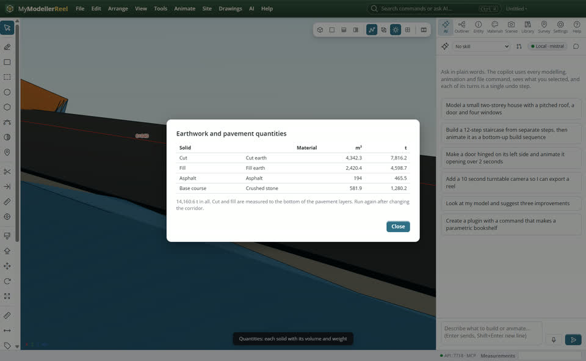

# Measure the earthwork volumes and the materials for a road

You have a road corridor through the ground and need its quantities: how much cut and fill, whether they balance, and what the road needs (asphalt, base course, topsoil), as numbers for a table and as solids you can see and export.



## In the app

1. Give the corridor its pavement layers (**Site › Change the corridor…**, `layers`: asphalt 0.1 m, base course 0.3 m…). Earthworks are then measured to the bottom of the pavement.
2. **Site › [Road earthwork volumes…](action:corridorVolumes)**: cut and fill areas at every section, the volumes between sections (average end areas), the running totals and the mass haul ordinate. The line on top gives the loose cut (bulking), the cut needed for the fill (shrinkage) and the balance: cut left over to export, or fill to bring in. Save it as CSV with `csv`.
   
3. **Site › [Earthwork and pavement solids…](action:corridorSolids)**: the cut body, the fill body, one solid per pavement layer and the topsoil strip (`topsoil`, in metres), in a group with their materials.
   
4. A section plane (**View › Section**) across the solids shows the layers: asphalt over the base course, on the fill.
   
5. The quantities table lists each solid with its material, volume and weight (t, from the material's density).
   

## Ask Plumb

> How much cut and fill does Road need with a bulking of 1.25 and a shrinkage of 0.9? Then make the earthwork solids with a 20 cm topsoil strip and give me the tonnages.

## From a script, the HTTP API or MCP

```js
await api.set_corridor({ id: 'Road', template: { layers: [
  { name: 'Asphalt', thickness: 0.1, material: 'Asphalt' },
  { name: 'Base course', thickness: 0.3, material: 'Crushed stone' },
] } });
const v = await api.corridor_volumes({ corridor: 'Road', bulking: 1.25, shrinkage: 0.9, csv: 'C:/jobs/road-volumes.csv' });
// v.totals: { cut, fill, net, cut_loose, fill_needs_cut, balance, verdict }, v.rows: one per station
const s = await api.corridor_solids({ corridor: 'Road', topsoil: 0.2 });
// s.solids: [{ name, material, volume_m3, tonnes }]
```

## Good to know

- Volumes use average end areas between the sections, every corridor interval (5 m by default): a smaller interval follows the ground more closely.
- The solids are built from the same sections, so their volumes match the table within a few per cent. They are not live: run the command again after changing the corridor (it replaces the solids it made before).
- Densities: asphalt 2.4 t/m³, crushed stone 2.2, gravel 2.0, cut earth 1.8, fill 1.9, topsoil 1.5.

## Related

- [Put a road through the ground and see the cut and fill](howto:road-through-terrain)
- [Work out cut and fill for a building pad](howto:cut-and-fill-for-a-pad)
