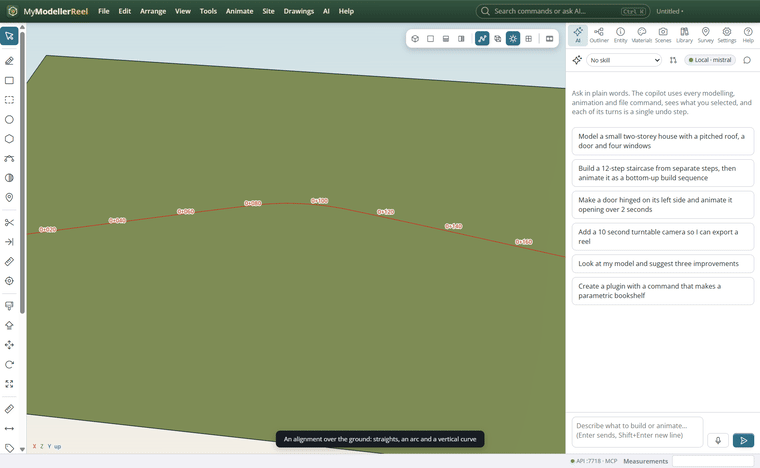
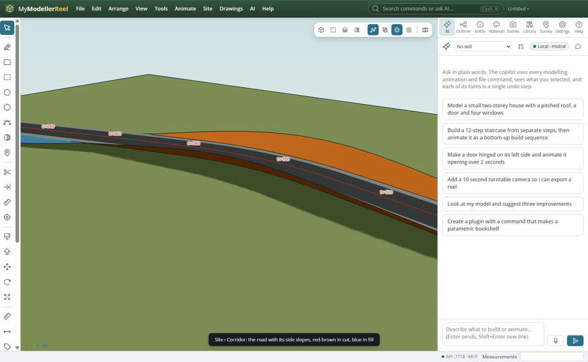
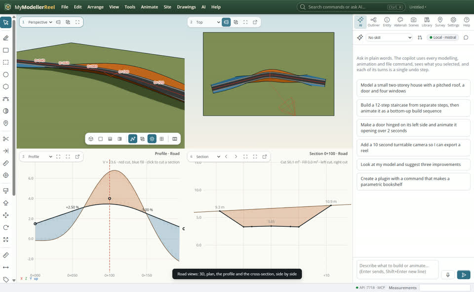
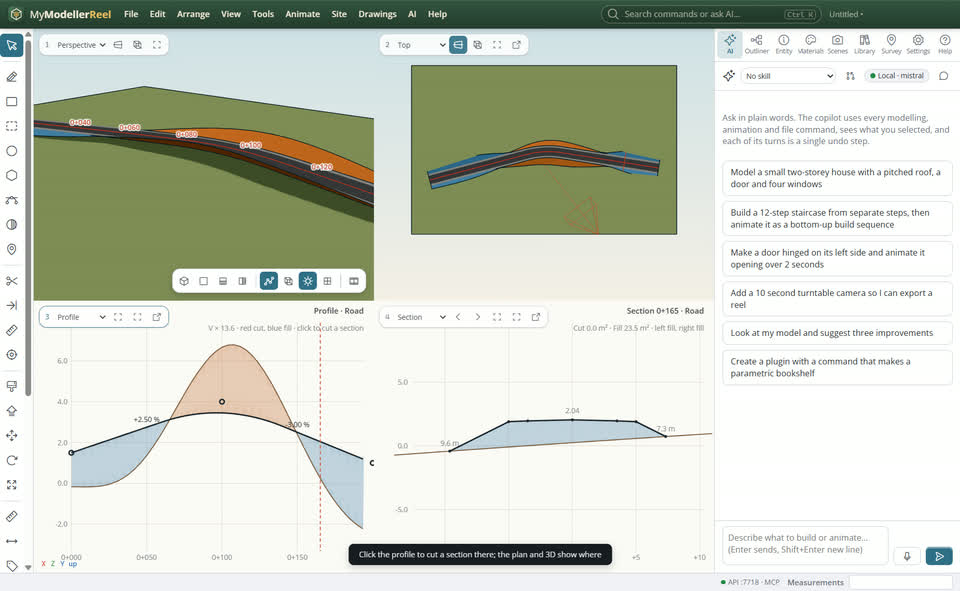
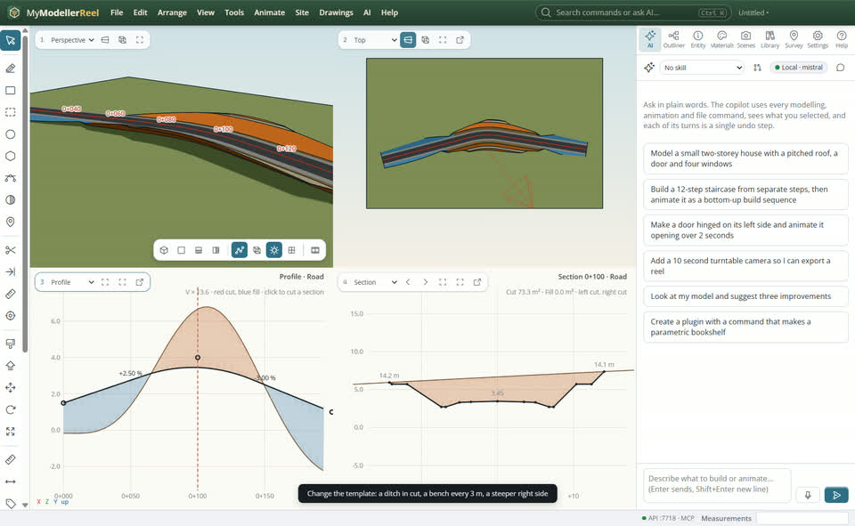
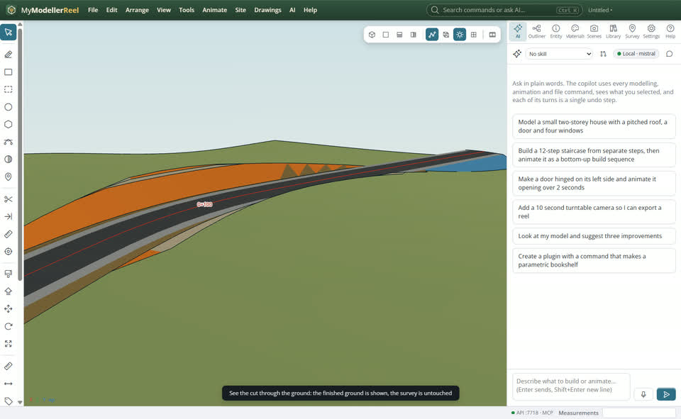

# Put a road through the ground and see the cut and fill

You have a terrain and want a road across it: see the trench it cuts through the hill and the bank it builds over the low ground, read its profile and cross-sections, and shape its side slopes, without changing the surveyed ground until you decide to.



## In the app

1. **Site › [Alignment…](action:alignment)**: the road's centreline over the ground: plan points with arcs, and a vertical profile (PVIs with vertical curves).
   
2. **Site › [Corridor…](action:corridor)**: choose the alignment and the ground. Lanes and shoulders are swept along it and the side slopes run out to the ground. The road is grey, slopes in cut red-brown, slopes in fill blue.
   
3. **Site › [Road views](action:roadViews)**: four panes at once: the 3D view, the plan, the long section (profile) and the cross-section. Red shading is cut, blue is fill.
   
4. Click anywhere in the profile to cut a section there; the ◀ ▶ buttons on the section pane step from one section to the next. A red line shows in the plan and the 3D view where the section is.
   
5. **Site › [Change the corridor…](action:editCorridor)**: add a ditch at the foot of the cuts, a bench every few metres of height, a different slope on the left or the right, pavement layers, or superelevation on the curves. Everything follows: the 3D, the profile, the sections.
   
6. **Site › [See the cut through the ground…](action:corridorSurface)**: shows the finished ground (the existing ground with the road let into it) and hides the existing ground. The surveyed ground itself is not changed; `show: false` brings it back.
   

When the design is settled, **Site › [Write the road into the ground…](action:applyCorridor)** makes the finished ground the terrain for good (one undo step).

## Ask Plumb

> Put a 7 m road along Main road over the Ground with 1.5:1 cuts and 2:1 fills, a ditch in the cuts, and show me the road views at station 120.

## From a script, the HTTP API or MCP

```js
await api.create_alignment({ name: 'Main road', points: [[-95, 25], [0, 0], [95, 15]], radii: [70], pvis: [[0, 1.5], [100, 4], [200, 1]], curves: [80] });
await api.create_corridor({ alignment: 'Main road', surface: 'Ground', name: 'Road', interval: 5,
  template: { lanes: [{ width: 3.5, crossfall: -2.5 }], shoulder: { width: 1.5, crossfall: -4 }, cut_slope: 1.5, fill_slope: 2 } });
await api.set_corridor({ id: 'Road', template: { ditch: { width: 0.6, depth: 0.6 }, bench: { every: 3, width: 2 }, right: { cut_slope: 1 }, superelevation: { rate: 5, runoff: 25 } } });
await api.road_views({ corridor: 'Road', station: 120 });
await api.road_section({ corridor: 'Road', station: 120 });  // points, ground, cut and fill areas
await api.road_profile({ corridor: 'Road' });                // ground and design every 2 m, grades
await api.corridor_surface({ corridor: 'Road' });            // see it; the ground is not edited
await api.apply_corridor({ corridor: 'Road' });              // write it into the ground
```

## Good to know

- The corridor is live: move an alignment point, change a PVI or the template and the slopes, the finished ground, the profile and the sections follow.
- Benches start from the road edge (or the ditch) and repeat every `every` metres of height. Superelevation tilts the lanes towards the inside of each arc, reaching `rate` % after `runoff` metres.
- Editing the PVIs by dragging them in the profile is not there yet: change them with `set_alignment` (or the Entity panel).

## Related

- [Measure the earthwork volumes and the materials for a road](howto:road-earthworks)
- [See the model from several sides at once: split, resize and detach views](howto:multiple-views)
- [Design an access road](howto:design-an-access-road)
