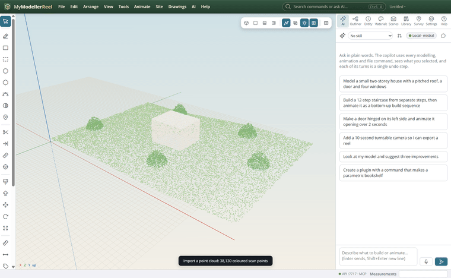
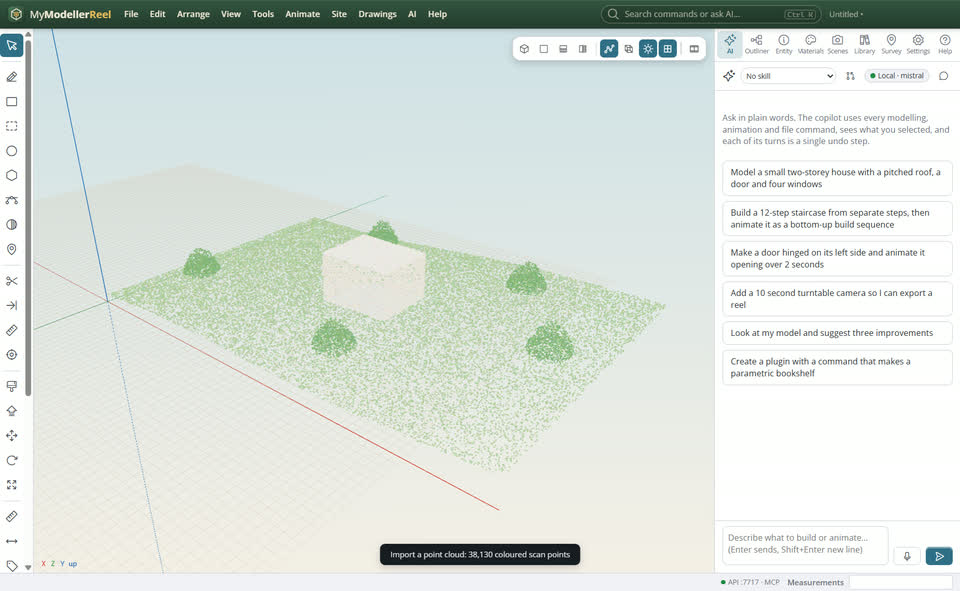
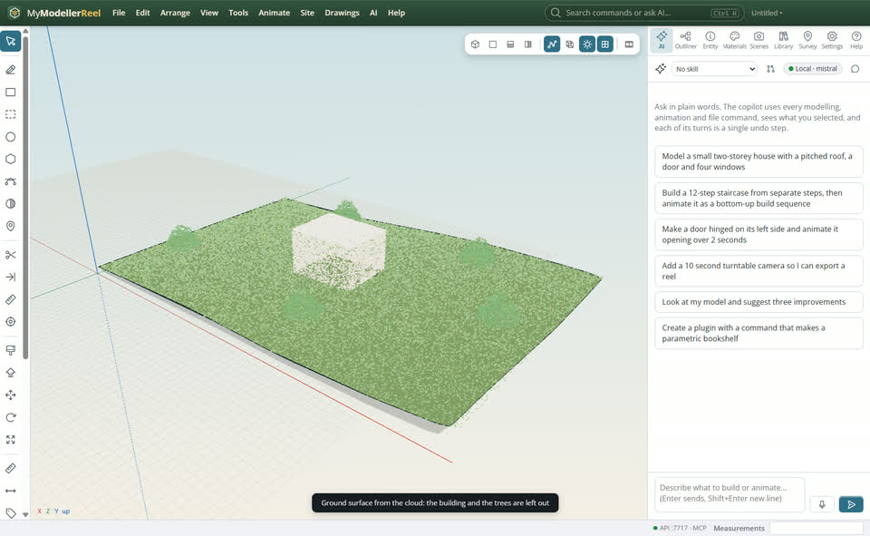
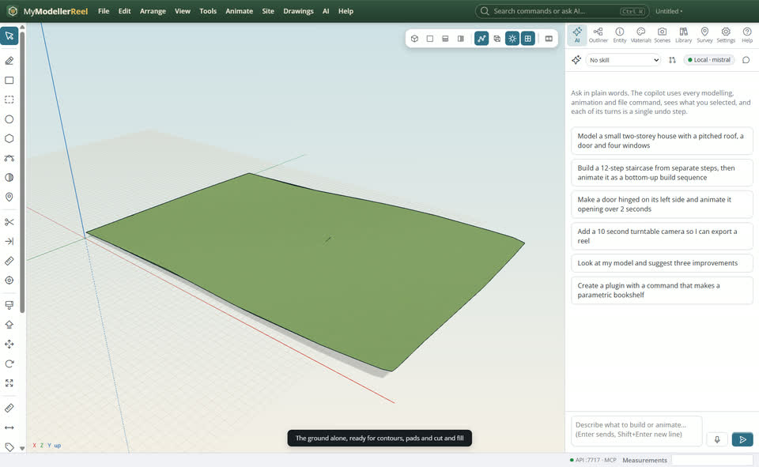
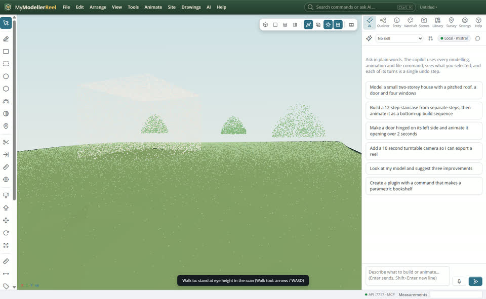

# Model over a scan and make the ground from it

You have a drone or laser scan of the site and want to design on it: see it in the model, get a terrain surface without the buildings and trees, and walk through it at eye height.



## In the app

1. **File › Import › [Import a point cloud](action:importCloud)** (PLY, LAS or XYZ / PTS / CSV text). Big clouds are thinned to 300,000 points; the first cloud sets the base point when its coordinates are large.
   
2. Select the cloud, **Site › [Ground surface from a point cloud](action:groundFromCloud)**: the lowest points per cell, within tolerance of the ground and its slope, become a TIN. Roofs and tree crowns are left out.
   
3. Hide the cloud to see the ground alone: contours, pads, cut and fill and profiles all work on it.
   
4. The [Walk](tool:walk) tool stands you at eye height (arrow keys or WASD, drag to look). The line, rectangle and tape tools snap to the cloud's points.
   

## Ask Plumb

> Import C:/scans/site.las, make the ground surface from it with a 2 m cell, and stand me at the south-west corner looking at the building.

Plumb runs the same commands as the steps above; with **AI › Propose AI changes for review** on, you accept or reject its changes first.

## From a script, the HTTP API or MCP

```js
await api.import_point_cloud({ path: 'C:/scans/site.ply', max_points: 300000 });
await api.classify_ground({ id: 'site', cell: 1, tolerance: 0.25, window: 20 });
await api.walk_to({ position: [10, 0, -5], look_at: [40, 2, -20] });
```

## Good to know

- LAZ (compressed LAS) and E57 are not read yet: convert them to LAS or PLY first (CloudCompare, PDAL).
- `window` must be wider than the biggest building: a scanner sees no ground under a roof, so the ground there comes from the points around it.
- The cloud's points are saved inside the model file, so the model stays one file.

## Related

- [Turn survey points into a surface](howto:survey-points-to-surface)
- [Read the terrain](howto:read-the-terrain)
