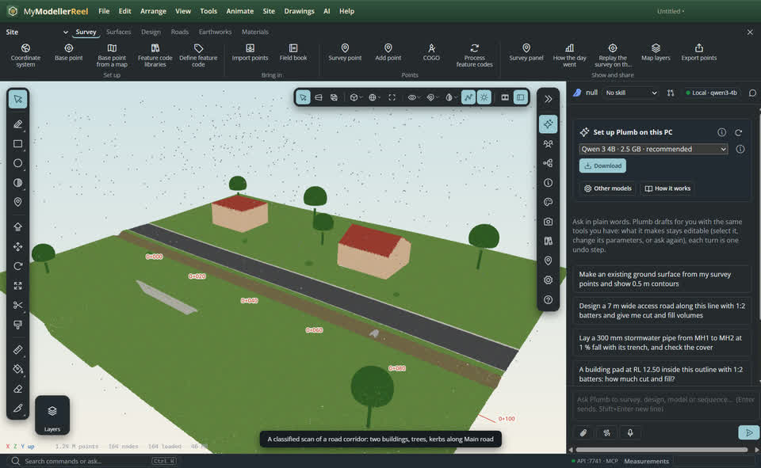
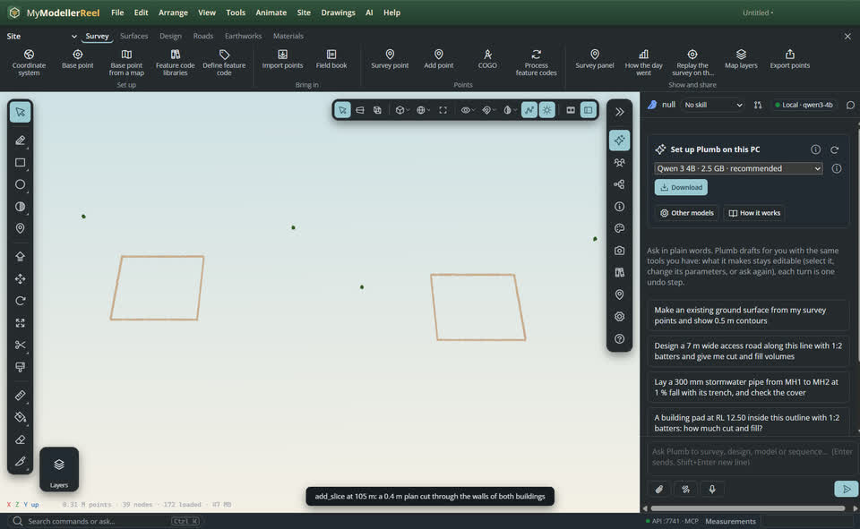
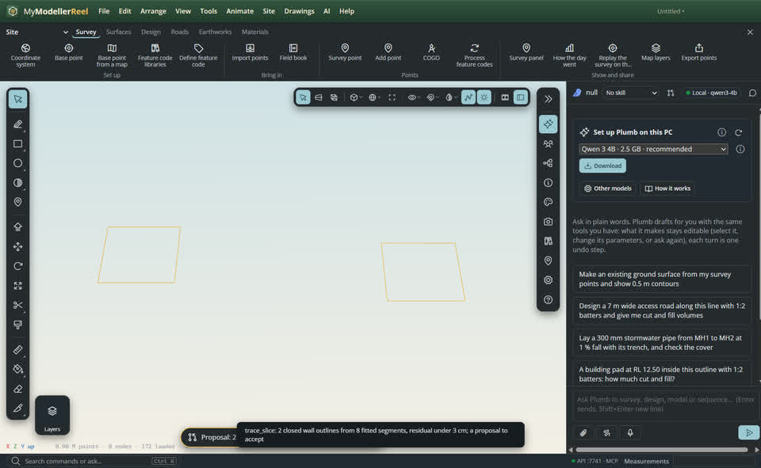
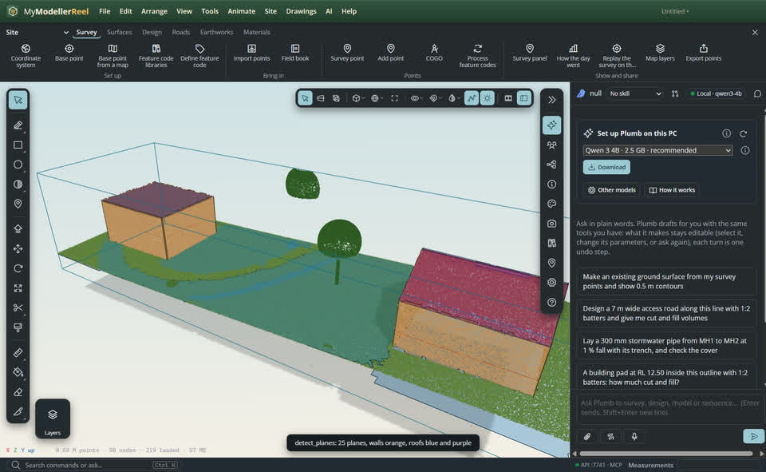
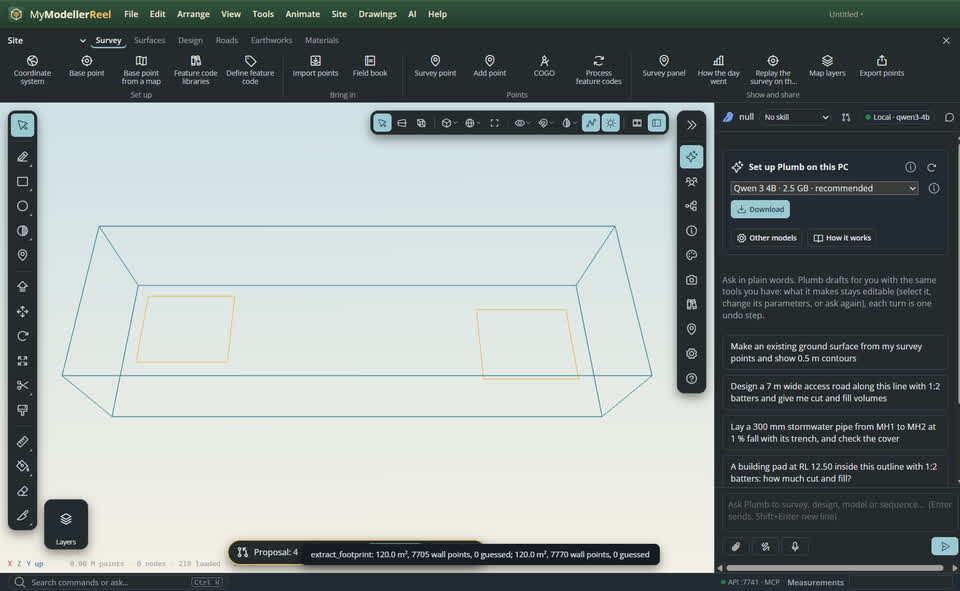
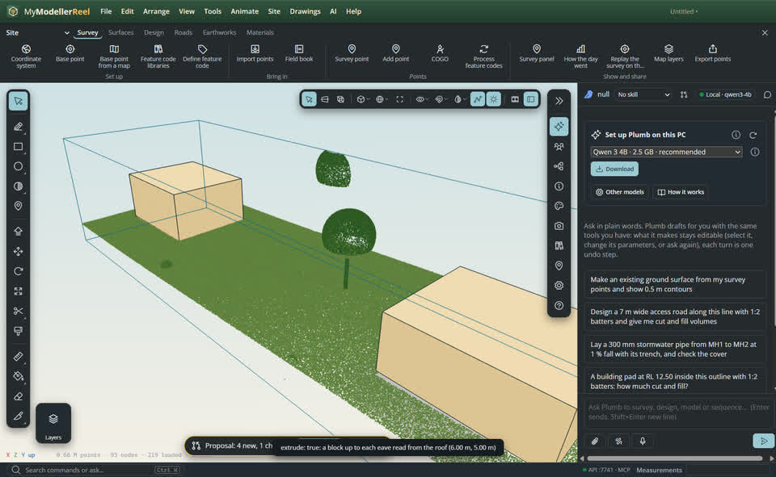
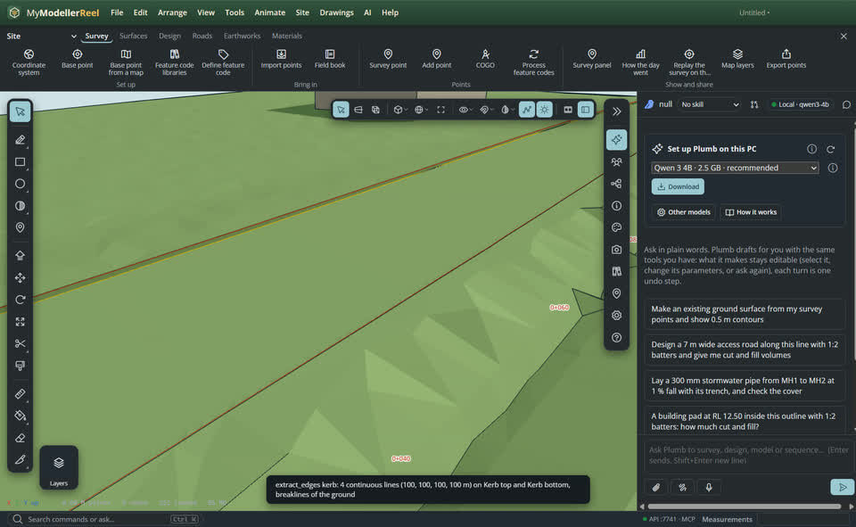

# Scan to plan: footprints, wall lines, kerbs and massing from a scan

Most scan work ends as linework and simple solids: building footprints for the site plan, wall lines at a level, kerb and edge-of-pavement lines, then blocks for the massing. Three commands turn the points into that drafting. **Building footprints** outlines each building from its wall points and squares it up. **Wall lines from a slice** fits straight lines to a plan cut and joins them at the corners. **Kerb lines** draws the kerb top and bottom along an alignment and can make the ground surface follow them. Each result goes on a named layer as plain curves and meshes that you can edit like any other drafting. Each one also carries a quality report, so you know which lines to check.

## In the app

1. Import the scan ([Import point cloud](do:import_point_cloud)) and classify it ([Classify point cloud](action:classifyCloud)): footprints read the building class, 6. Here: a road corridor with two buildings and *Main road* along its centreline ([create_alignment](do:create_alignment)).
   
2. Cut a plan through the walls ([Add a slice](do:add_slice): a level, 0.4 m thick, where every building has walls; `above: 'ground'` measures it from the ground).
   
3. [Wall lines from a slice](action:traceSlice): straight segments fitted to the slice points, met at the corners, extended to the walls they stop on. Gaps up to a door's width (`max_gap`, 1 m) are bridged and reported as guessed; any line with a guessed gap is drawn orange. `centre_lines: true` also draws a centre line for each wall, with its thickness.
   
4. [Detect planes](action:detectPlanes) shows the walls and roofs the footprints will be built from (see [Detect planes, corners and kerbs](howto:detect-planes-and-corners)).
   
5. [Building footprints from a scan](action:extractFootprints): one closed curve per building on the **Footprints** layer. The curve is squared to the building's main direction, short jogs are removed, and each edge sits on its wall. Its `meta` has the area, the perimeter and the quality: points and residuals for each edge, and the edges that were guessed (no wall points there, so the roof edge was used). Guessed edges are drawn orange.
   
6. With `extrude: true`, each footprint also gets a block from the ground up to the eave height read from the roof, on the **Massing** layer. The block follows its footprint: edit the curve and the block updates.
   
7. [Kerb lines along an alignment](action:extractKerbs): the kerb top and bottom on each side, joined where a parked car hides a stretch (that stretch is marked as guessed), on the **Kerb top** and **Kerb bottom** layers. With `as_breaklines: true`, the ground surface follows them. A ground made by [classify_ground](do:classify_ground) is re-triangulated on the lines. A TIN surface gets them as drawn breaklines.
   
8. Plumb runs these commands with `propose: true`, so the result waits for you: [accept or reject](do:propose) it. Accepting it is one undo step. Rejecting it leaves the model as it was.

## The settings, and what the quality report says

- **Footprints** (`extract_footprint`): `classes` (default `[6]`), `band` (`[1, 2.5]` m above `above: 'ground'`, the wall band; with no walls in the band, the roof outline seen from above is used instead), `tolerance_deg` (5°: edges this close to the main direction, or square to it, are snapped), `min_edge` (0.3 m: shorter jogs are removed), `regularise: false` keeps the shape as found, `within` a clip, `extrude`. Quality: `points`, mean and max distance of the wall points from their edge, and `guessed` (edges with points along less than half their length).
- **Wall lines** (`trace_slice`): `classes` (`[6]` leaves the ground and trees out), `distance` (0.03 m off the line at most), `min_length` (0.3 m), `max_gap` (1 m, a door), `centre_lines`. Quality for each line: segments, points, mean and max residual, and the guessed gaps with where they are and how long.
- **Edges** (`extract_edges`): `kind` is `kerb`, `edge_of_pavement` (the low side of each step), `step` (any height jump) or `wall_top`. For the cross-profile kinds, give an `alignment` or two `points`, plus `spacing` (1 m), `width` (10 m on each side) and `gap` (5 m: a line that stops and carries on within this distance is joined, and the join is guessed). Quality: profiles, coverage and residual, plus the guessed gaps. `as_breaklines` with `surface` to use one surface only.
- On the synthetic corridor scan the footprints are within 5 cm of the truth with exact right angles, the blocks are within 10 cm of the eaves, and the kerbs are within 3 cm.

## Ask Plumb

> Draft the building footprints from the scan on a Footprints layer, with massing.

> Trace the walls in the 1.2 m plan cut.

> Draw the kerb lines along Main road and make the ground follow them.

## From a script, the HTTP API or MCP

```js
await api.extract_footprint({ classes: [6], extrude: true, propose: true });   // → { count, footprints: [{ id, area, perimeter, eave, roof, solid, quality }] }
await api.propose({ action: 'accept' });
await api.add_slice({ at: 'elevation', z: 1.2, above: 'ground', name: 'Plan cut' });
await api.trace_slice({ name: 'Plan cut', centre_lines: true });              // → { segments, closed, lines: [{ id, closed, length, area, quality }] }
await api.classify_ground({ id: 'Site scan' });
await api.extract_edges({ kind: 'kerb', alignment: 'Main road', as_breaklines: true }); // → { edges: [{ id, layer, length, height, quality }], breaklines }
```

The replies are short: counts, plus at most 50 results with their quality summary. The full report for each edge or gap is in the entity's `meta.quality`.

## Related

- [Slice a scan: plans at a level, cross-sections at stations, square-on views](howto:slice-a-scan)
- [Detect planes, corners and kerbs in a scan](howto:detect-planes-and-corners)
- [Classify a point cloud](howto:classify-a-point-cloud)
- [Model over a scan and make the ground from it](howto:scan-to-ground)
