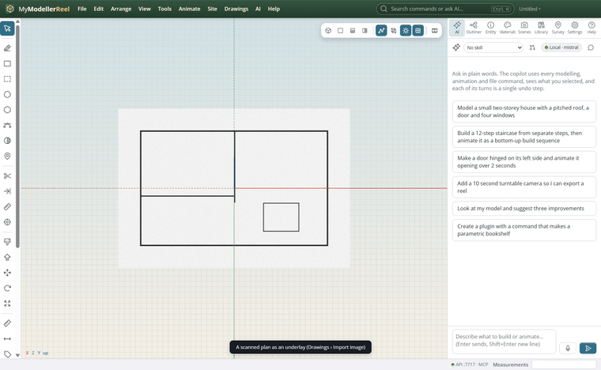
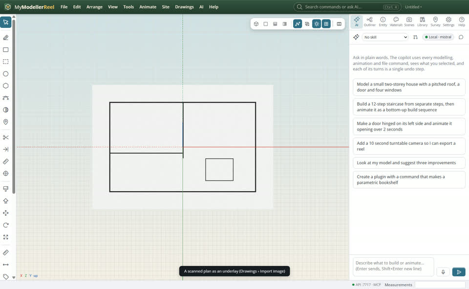
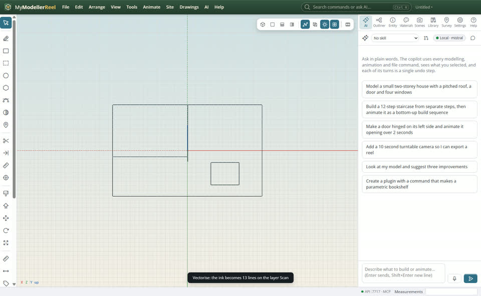
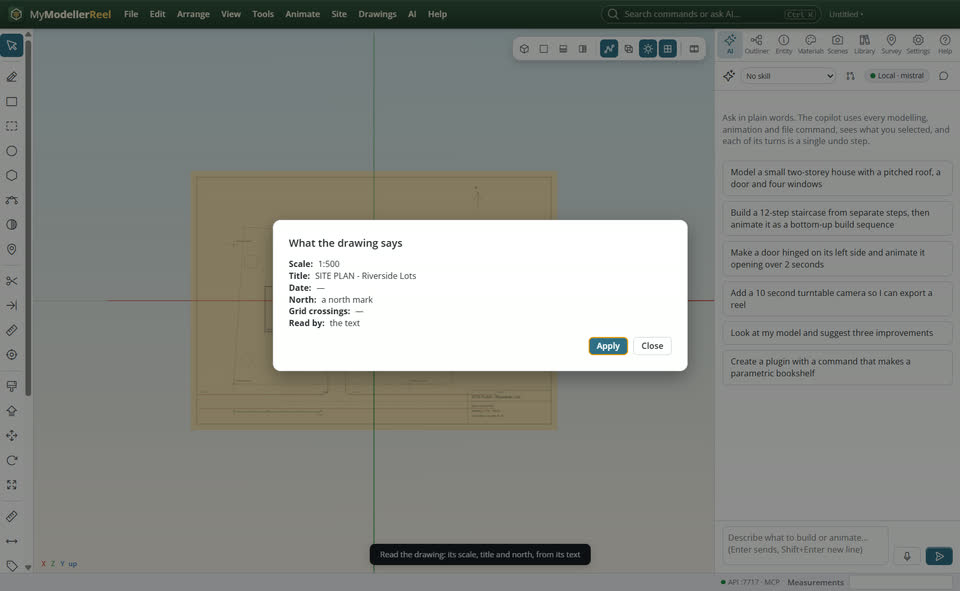
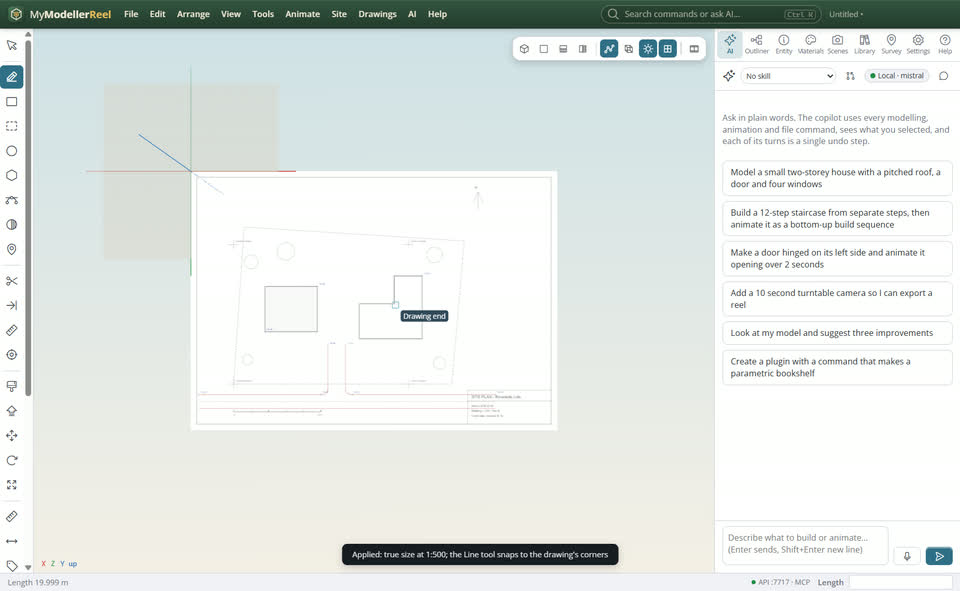

# Turn a scanned drawing into lines, and let the copilot read a drawing

You have a paper plan as a scan, or a PDF from the architect, and want lines to build on, the right scale and the title without typing them in.



## In the app

1. **Drawings › Import image** places a scan (PNG, JPG, TIFF) as an underlay; give it its scale.
   
2. Select it, **Drawings › [Vectorise a scanned drawing](action:vectorise)**: dark ink is thinned to centre lines and traced into curves on the layer *Scan*, simplified. Join, trim and push / pull them like any linework.
   
3. For a PDF, **Drawings › [Read the drawing](action:readDrawing)**: its scale text, title, date, north mark and labelled grid lines are found. **Apply** sets the scale, names the drawing and georeferences it when the grid has coordinates.
   
4. **Drawings › [Snap to drawings](action:snapDrawings)**: the drawing tools snap to the PDF's line ends and middles without extracting its linework first.
   

## Ask the copilot

> Read the site plan, apply its scale, then trace the boundary on it.

With a vision model set in AI settings, `read_drawing` also sends a picture of the sheet to it, which helps with drawings whose text is not in the PDF.

## From a script, the HTTP API or MCP

```js
await api.import_image({ path: 'C:/scans/plan.jpg', scale: '1:100' });
await api.vectorise_underlay({ id: 'plan.jpg', threshold: 128, min_length: 12 });
await api.import_pdf({ path: 'C:/drawings/site-plan.pdf', name: 'Site plan' });
await api.read_drawing({ id: 'Site plan', apply: true });
await api.set_style({ snap_underlays: true });
```

## Good to know

- Vectorising works best on clean, high-contrast scans: raise `threshold` for faint pencil, and `min_length` to drop specks.
- Lettering on a scan becomes short curves: hide it with a window, or delete them.

## Related

- [Put a PDF site plan in place](howto:put-a-pdf-in-place)
- [A floor plan to 3D](howto:floor-plan-to-3d)
