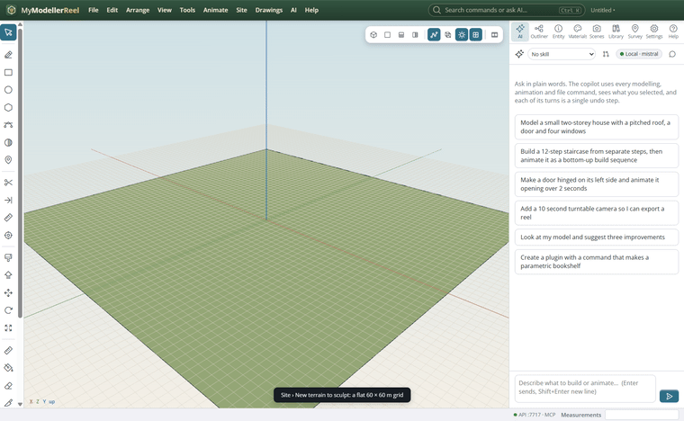
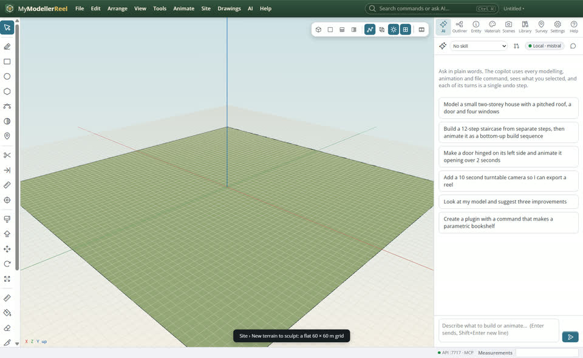
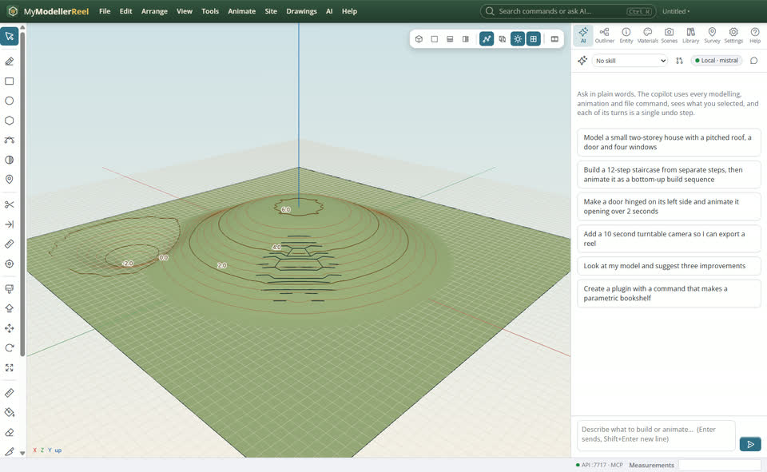
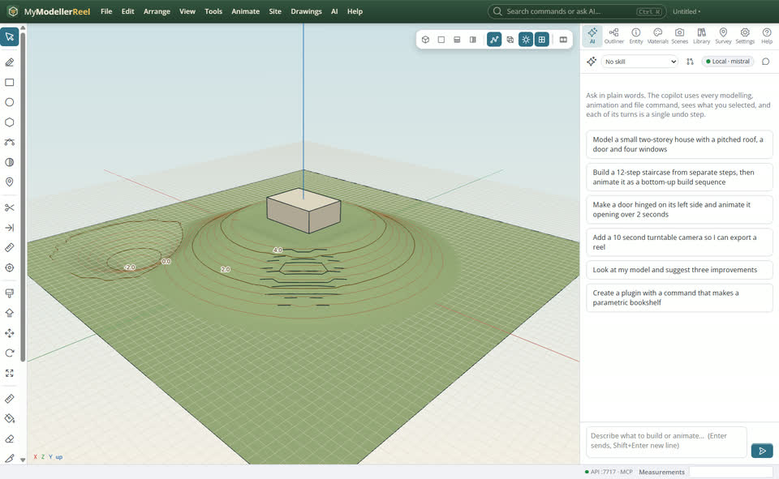

# Sculpt a terrain for a concept

You want to shape ground by hand for a concept: mounds, hollows, a terraced slope, a flat platform, with things sitting on it.



## In the app

1. **Site › New terrain to sculpt…** [New terrain](action:newTerrain): a flat grid, its size and spacing.
   
2. The Sculpt tool [Sculpt](tool:sculpt) (V): type the brush in the Measurements box (`raise 8 1`: operation, radius, strength), then click or drag. Shift lowers. Also flatten, smooth, noise and terrace.
   
3. **Site › Stamp a platform…** [Stamp](action:stamp): flat inside an outline, blended to the ground around it.
   
4. **Site › Drape onto a surface…** [Drape](action:drape): things sit on the ground, lines take its heights.
   

## Ask Plumb

> Make a 60 by 60 m terrain, raise a gentle mound in the middle, flatten a 12 m square platform on it at 2 m, and put the pavilion on top.

Plumb runs the same commands as the steps above; with **AI › Propose AI changes for review** on, you accept or reject its changes first.

## From a script, the HTTP API or MCP

```js
await api.create_terrain({ width: 60, depth: 60, spacing: 1, name: 'Ground' });
await api.sculpt_terrain({ id: 'Ground', at: [0, 0, 0], operation: 'raise', radius: 18, inner: 4, strength: 3 });
await api.stamp({ id: 'Ground', outline: 'Platform', elevation: 2 });
await api.drape({ ids: ['Pavilion'], surface: 'Ground' });
```

## Good to know

- On a survey surface, strokes are kept as a design adjustment on top: the surveyed points never move, and the strokes replay when the surface rebuilds.

## Related

- [Design a building pad with batter slopes](howto:design-a-pad)
