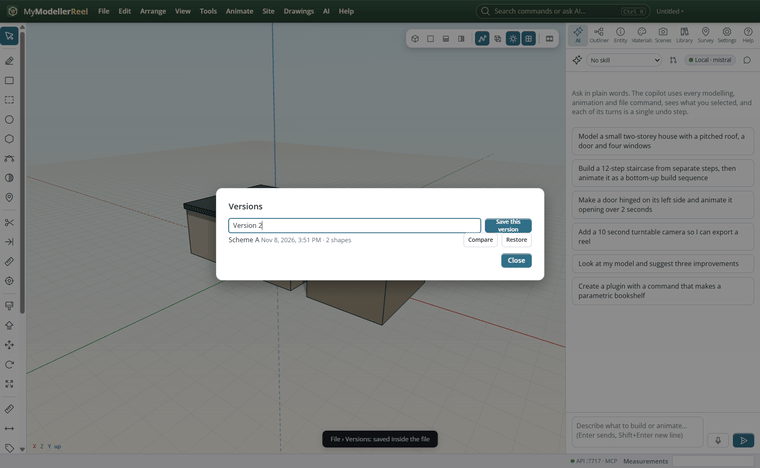
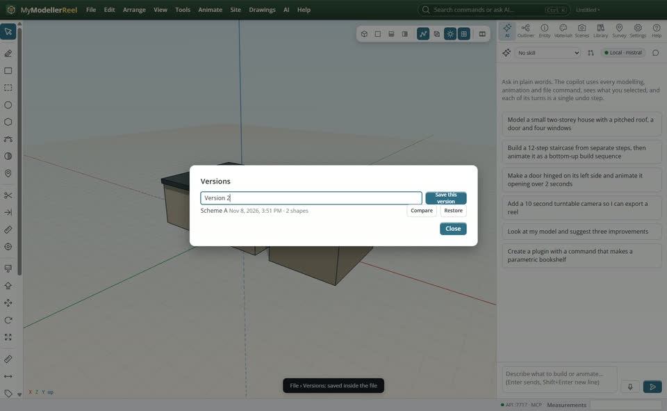
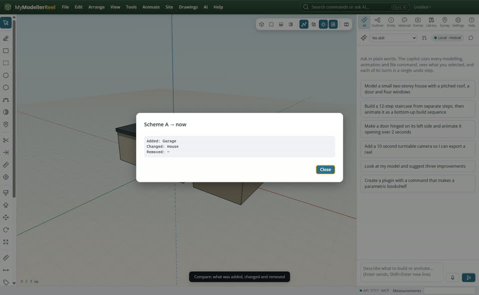
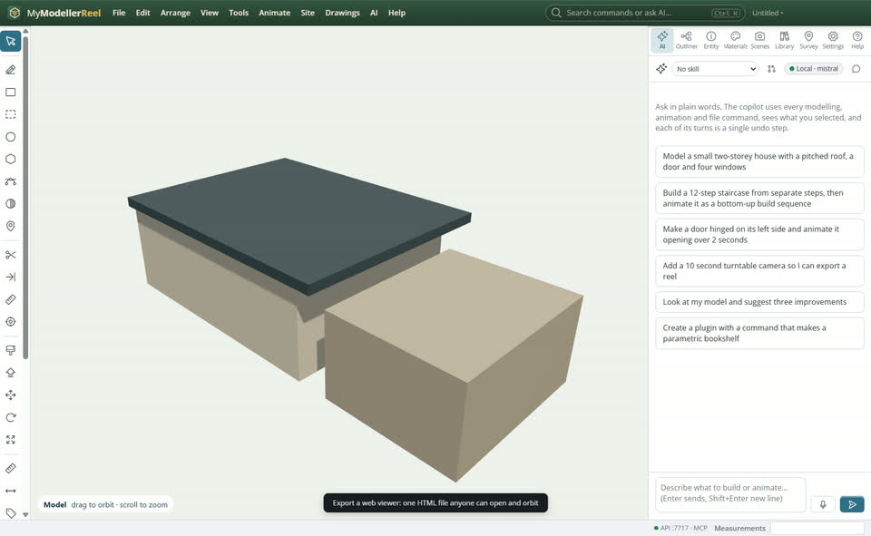

# Share a model: a web page, AR on a phone, a 3D print, versions

You want someone without the app to look at the design, to see it on a table through a phone, to print it, or to keep the scheme you had before changing it.



## In the app

1. **File › [Versions…](action:versions)**: save the model as a named version inside its file before a big change; **Restore** goes back (undo returns to now).
   
2. **Compare** lists what was added, changed and removed since that version.
   
3. **File › Export › [Export a web viewer](action:webViewer)**: one HTML file with the model, its animation and orbit controls. Email it; it opens in any browser, offline.
   
4. **[Export USDZ](action:exportUsdz)** for AR Quick Look on an iPhone or iPad, **[Export 3MF](action:export3mf)** for a slicer (units in metres, colours kept), and **[Compress a GLB](action:compress)** (meshopt or Draco) to make a GLB much smaller.

## Ask the copilot

> Save this as version "Scheme A", then export a web viewer and a 3MF of the house to my desktop.

## From a script, the HTTP API or MCP

```js
await api.save_version({ name: 'Scheme A' });
await api.compare_versions({ from: 'Scheme A' });
await api.restore_version({ name: 'Scheme A' });
await api.export_web_viewer({ path: 'C:/out/house.html' });
await api.export({ format: 'usdz', path: 'C:/out/house.usdz' });
await api.export({ format: '3mf', path: 'C:/out/house.3mf' });
await api.compress_glb({ path: 'C:/out/house.glb', method: 'meshopt' });
await api.list_autosaves({});
```

## Good to know

- The app also keeps an automatic copy every five minutes while you work (the last 20, with scans, drawings and audio): `list_autosaves`, `restore_autosave`.
- The web viewer page carries three.js inside it (about 1 MB plus the model), so it needs no network.

## Related

- [Export to IFC, DXF or LandXML for BIM and CAD tools](howto:share-with-bim-tools)
- [Present a design](howto:present-a-design)
