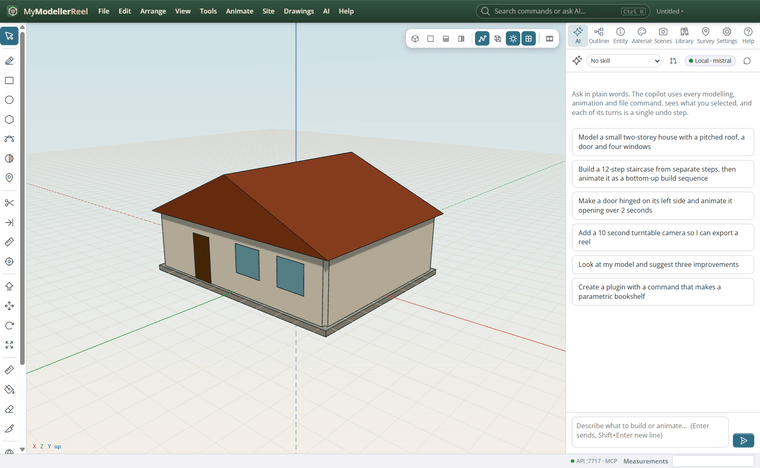
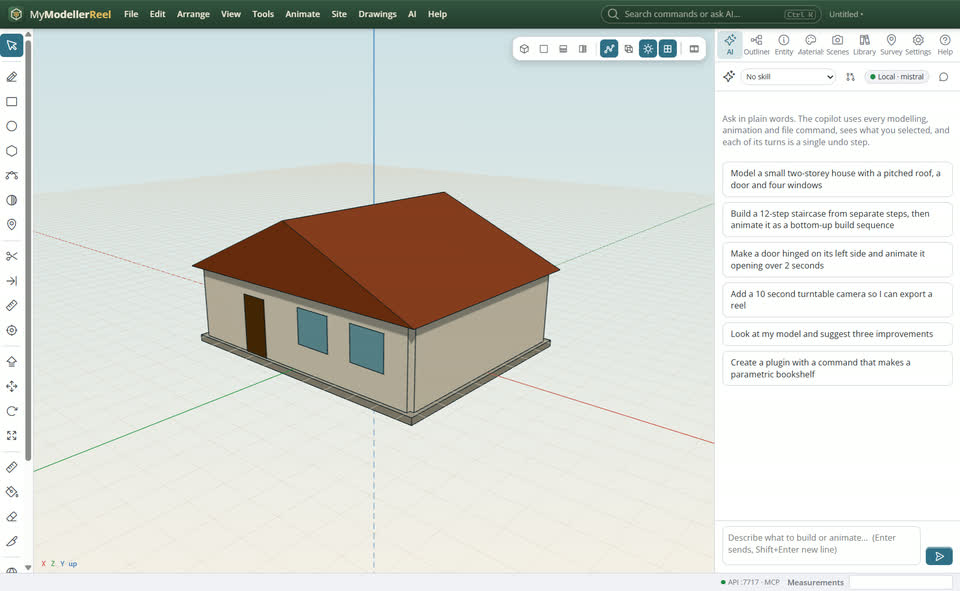
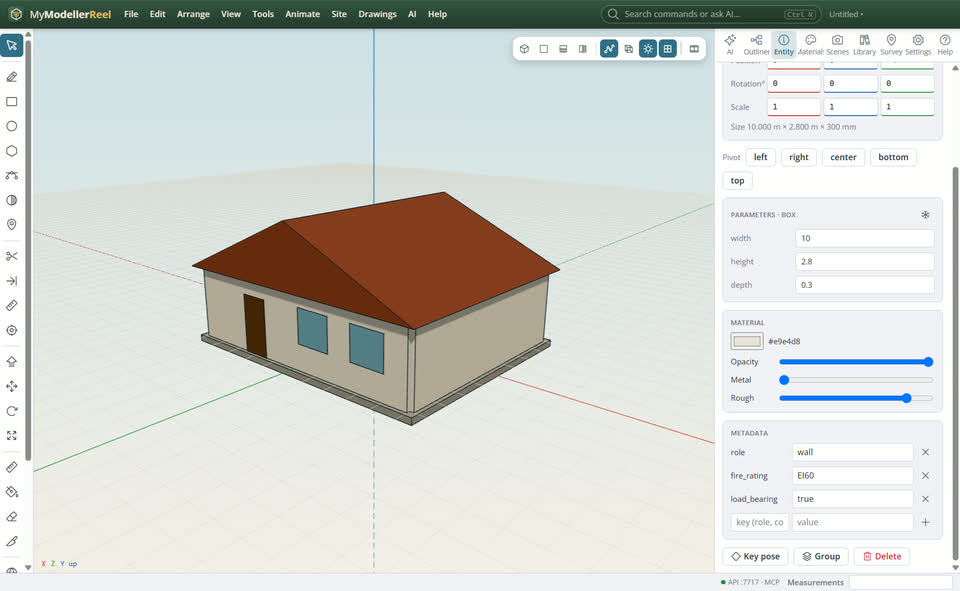
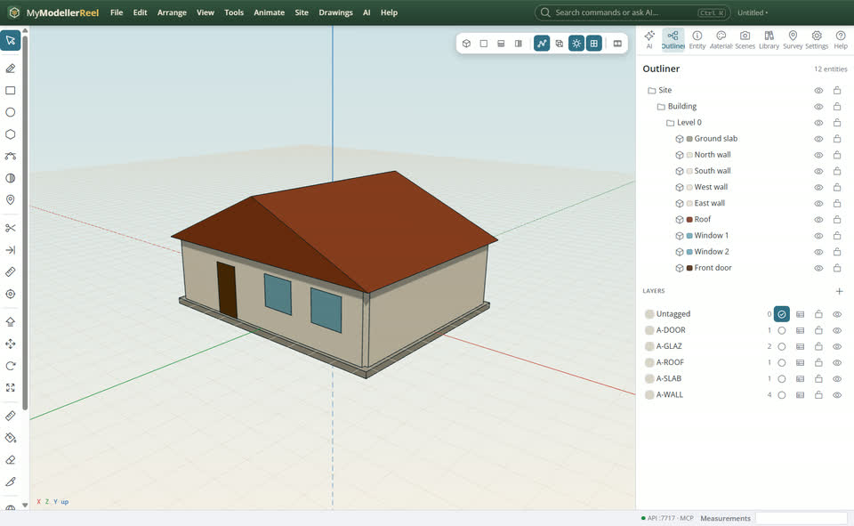

# Export to IFC, DXF or LandXML for BIM and CAD tools

You want others to open your model in their BIM tool (IFC), CAD (DXF) or survey software (LandXML), with the right classes, layers and coordinates.



## In the app

1. Give parts a role in their data (wall, slab, roof, door, window, column, beam…): it becomes their IFC class. Names work too.
   
2. Everything else in the data (fire rating, cost, supplier…) goes out as a property set.
   
3. **File › Export IFC…** [Export IFC](action:exportIfc) (IFC4, or IFC4X3 for site work), **Export DXF…** [Export DXF](action:exportDxf), **Export LandXML…** [Export LandXML](action:exportLandxml). Layers, colours and the base point travel along.
   

## Ask Plumb

> Export the model to IFC4 at C:\out\house.ifc with walls, doors and windows as their IFC classes.

Plumb runs the same commands as the steps above; with **AI › Propose AI changes for review** on, you accept or reject its changes first.

## From a script, the HTTP API or MCP

```js
await api.set_metadata({ ids: ['North wall'], values: { role: 'wall', fire_rating: 'EI60' } });
await api.export({ format: 'ifc', path: 'C:/out/house.ifc' });
await api.export({ format: 'dxf', path: 'C:/out/site.dxf', coordinates: 'project' });
await api.export({ format: 'landxml', path: 'C:/out/survey.xml' });
```

## Good to know

- `selection: true` exports only what is selected.
- IFC georeferencing comes from the base point (IfcMapConversion).

## Related

- [Bring in a LandXML, IFC or DXF file](howto:bring-in-landxml-ifc-dxf)
