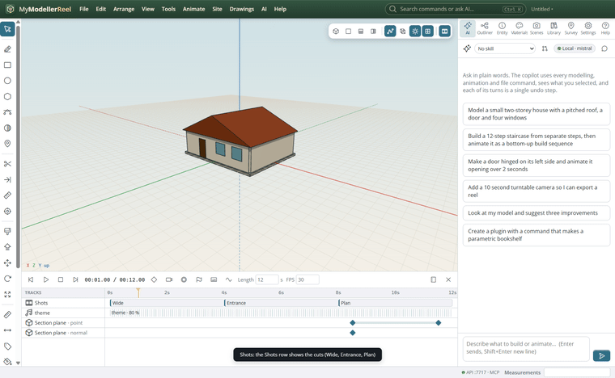
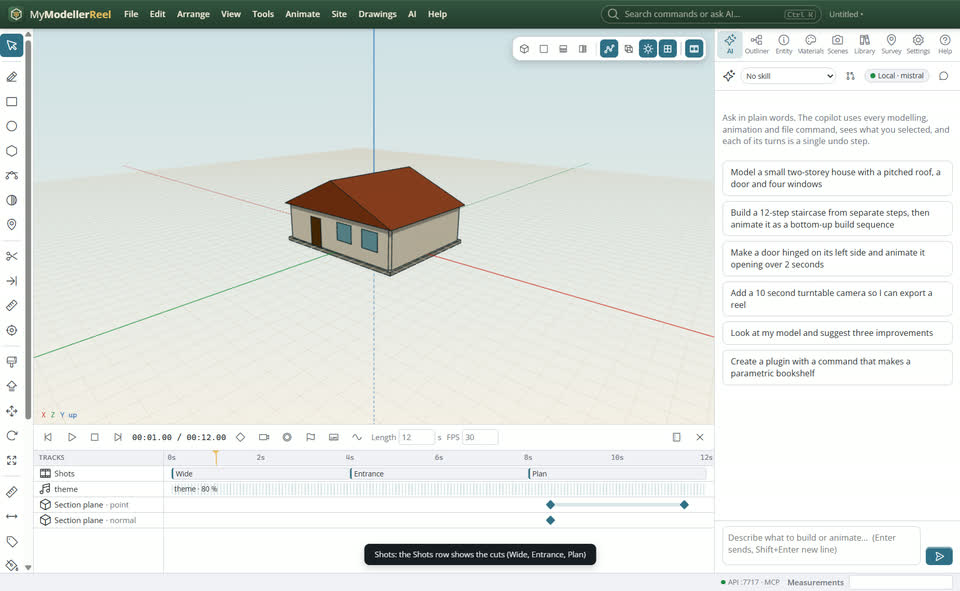
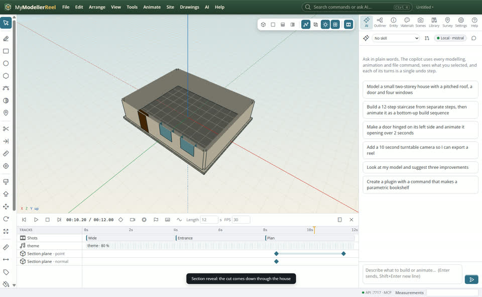
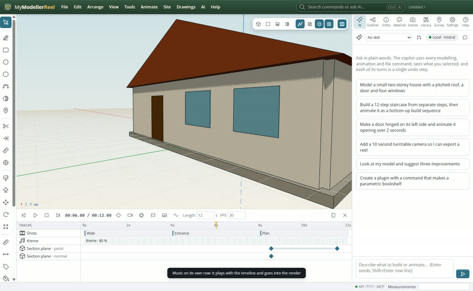

# Cut a film: camera shots, music and a section reveal

You want a short film of the design: a few camera angles cut together, a soundtrack, and the section plane sweeping through to show inside.




## In the app

1. Frame a view, **Animate › Add a shot from this view…** [Shot](action:addShot) with its start and end; again for the next angle. A shot can move (position_end). The Shots row shows the cuts.
   
2. **Animate › Section reveal…** [Reveal](action:sectionReveal): the cut sweeps through the model over the time you give.
   
3. **Animate › Add music or a voiceover…** [Audio](action:addAudio): MP3, WAV, OGG or M4A from the playhead, with fades. It plays with the timeline and is mixed into the render.
   
4. **Animate › Render video**: MP4 or WebM with the sound.

## Ask the copilot

> Make a 12-second film: a wide shot for 4 seconds, a slow push-in to the entrance, then a plan section rising through the house, with C:\music\theme.mp3 fading in.

The copilot runs the same commands as the steps above; with **AI › Propose AI changes for review** on, you accept or reject its changes first.

## From a script, the HTTP API or MCP

```js
await api.add_shot({ name: 'Wide', start: 0, end: 4, position: [20, 10, 22], target: [0, 1, 0], lens: 24 });
await api.add_shot({ name: 'Entrance', start: 4, end: 8, position: [8, 2, 10], target: [0, 1.5, 4], position_end: [4, 1.8, 7] });
await api.animate_section({ normal: [0, 1, 0], start: 8, end: 12 });
await api.add_audio({ path: 'C:/music/theme.mp3', start: 0, fade_in: 1.5, fade_out: 2 });
await api.render_video({ path: 'C:/out/film.mp4' });
```

## Good to know

- Shots win over camera keyframes while they run.
- The filled section caps come back when the plane stops moving.

## Related

- [Make a construction sequence video](howto:construction-sequence-video)
