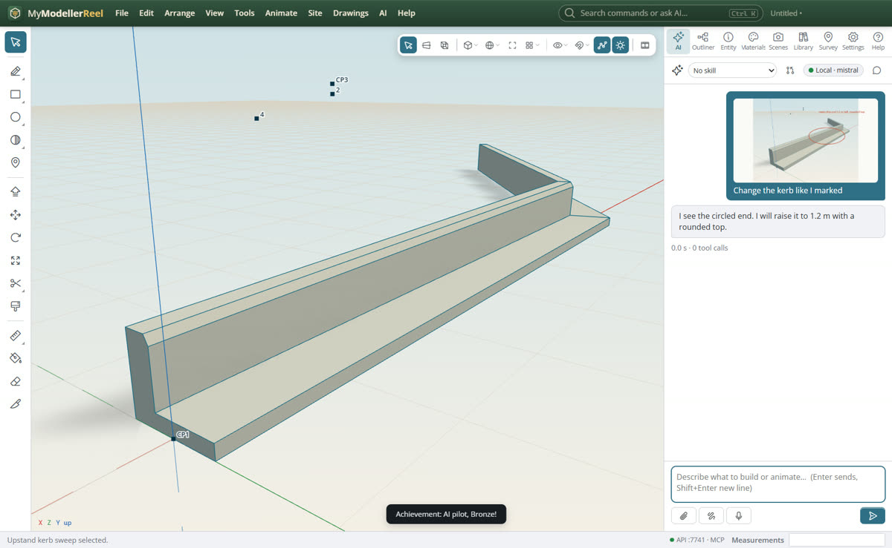
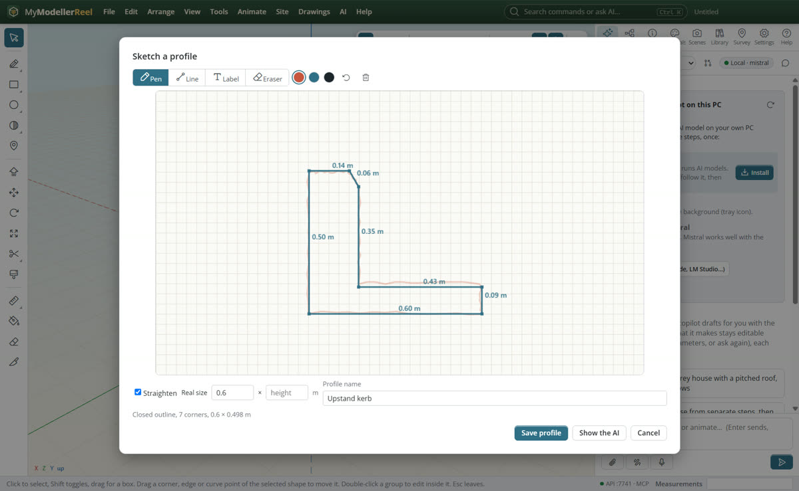
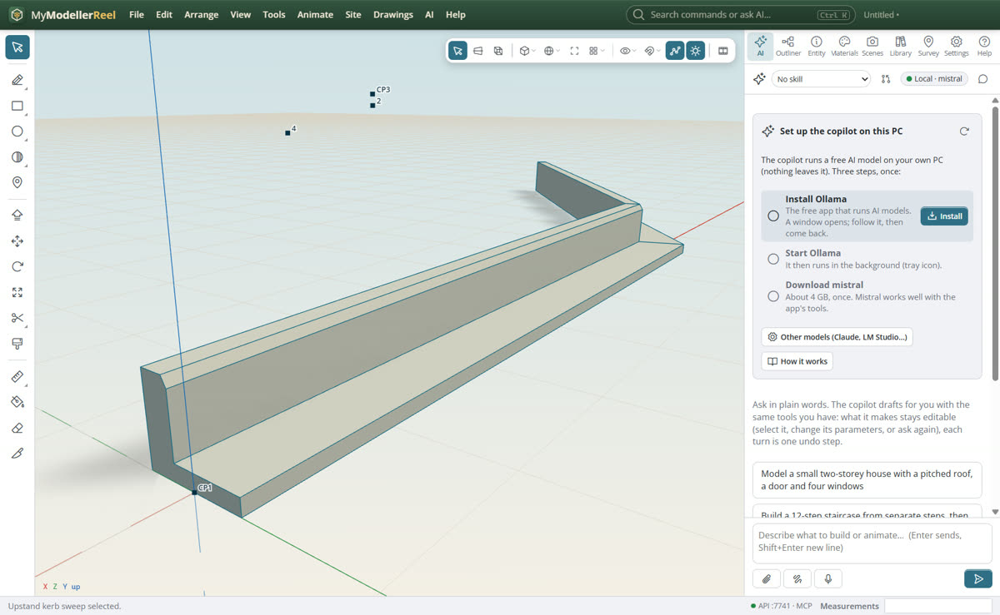

# Show the copilot a picture or a sketch

Some shapes are quicker to draw than to describe. Show the copilot a photo, a screenshot or a sketch, or mark up the
model itself; sketch a profile by hand and get clean, dimensioned lines without drawing every offset.

## In the app

1. In the AI chat, click the paperclip to attach a picture, or paste (Ctrl+V) or drop one on the chat. It waits above
   the message box until you send; the cross removes it.
2. Click the sketch button (or **AI › Sketch for the AI…** [Sketch for the AI](action:sketchForAi)) to draw **over the
   view** or on **paper**: pen, straight line, label and eraser, three inks, Undo (Ctrl+Z). **Attach to message** puts
   it in the chat.
   
3. To sketch a profile, use **Sketch a profile…** [Sketch a profile](action:sketchProfile) (in the Library's profiles,
   or the command search). Draw the outline freehand; **Straighten** shows it as straight sides with tidy angles and
   each side's length. Type a real width or height, name it, and **Save profile**. **Show the AI** sends it to the
   copilot instead, with the cleaned points as numbers.
   
4. Sweep the new profile along a curve like any other.
   

## Ask the copilot

> (with a photo of a garden wall) Model this wall along the curve I selected: same coping, 1.2 m tall.

> (with a sketch over the view) Change the kerb like I marked.

## From a script, the HTTP API or MCP

```js
await api.sketch_profile({ name: 'Upstand kerb', strokes: [[[300, 440], [300, 160], [380, 160], [400, 190], [400, 380], [640, 380], [640, 440], [302, 438]]], width: 0.6 });
await api.sweep({ path: 'Kerb line', profile: 'Upstand kerb' });
```

## Good to know

- Claude and OpenAI-compatible vision models read pictures. Of the local models, gemma3, qwen2.5vl and llava do; others
  get a sketch's cleaned outline as numbers but not the picture.
- Pictures are made smaller (longest side 1568 px) before they are sent, so they cost fewer tokens.
- Straighten snaps a side to a 15° step when it is within 7°; other angles stay as drawn. An outline closes when it
  ends near where it started; an open line is saved as a 5 cm strip.

## Related

- [Ask the copilot to build or change something](howto:ask-the-copilot)
- [Run a kerb along a curve that stays live](howto:live-sweep-along-a-curve)
