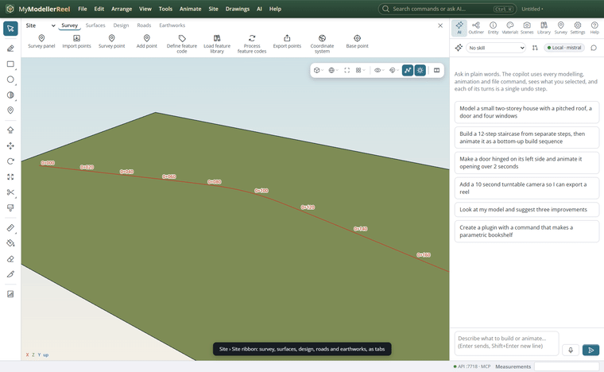
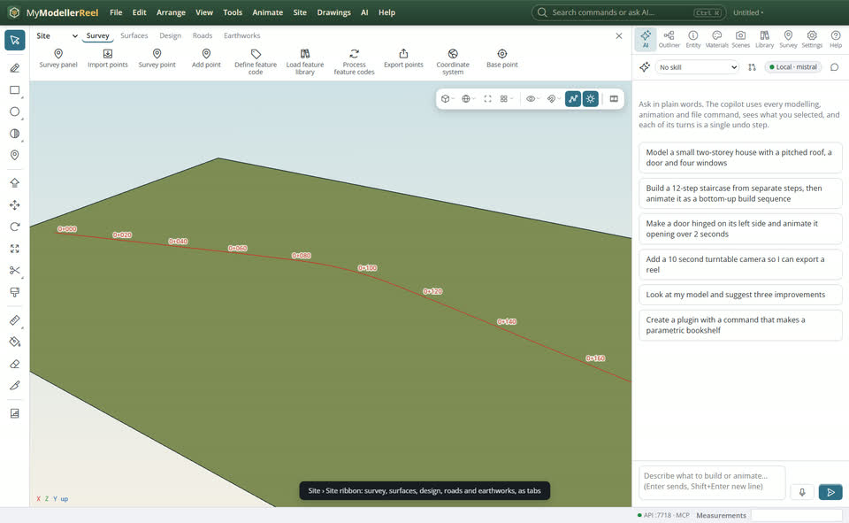
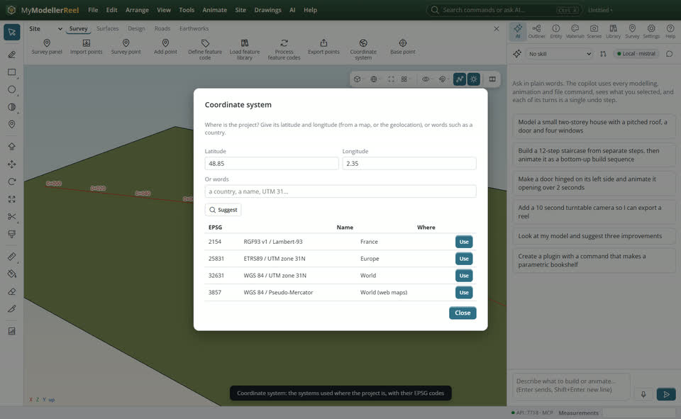
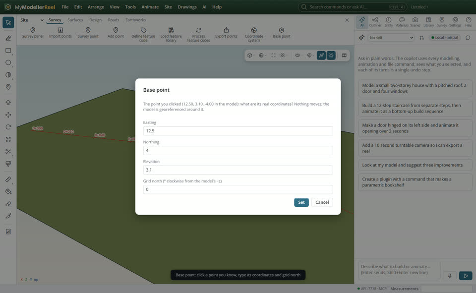

# Set up a site: the Site and Drawings ribbons, the coordinate system and the base point

You want the site tools where you can see them, a PDF taken from import to model step by step, the right coordinate system without knowing its EPSG number, and the model placed on real coordinates from a point you know.



## In the app

1. **Site › [Site ribbon](action:ribbonSite)**: the site tools by what you are doing, as tabs: Survey, Surfaces, Design, Roads, Earthworks. Each button names its tool. The ribbon stays open until you close it, and comes back next time.
   
   
2. **Drawings › [Drawings ribbon](action:ribbonDrawings)**: a PDF or image from start to finish: 1 Bring in, 2 Scale, 3 Place on the map, 4 Take lines out, 5 Clean up, 6 To the model. Selecting a drawing opens it for you the first time.
   
3. **Site › [Coordinate system…](action:coordSys)**: type the project's latitude and longitude (or keep the geolocation), or words such as a country; the systems used there come with their EPSG codes. **Use** records one.
   
4. **Site › [Base point](action:basePoint)**: click a point of the model whose real coordinates you know (a survey mark, a corner), then type its easting, northing, elevation and grid north. Nothing moves; the model and its survey points take those coordinates.
   

## Ask Plumb

> The project is in Paris: which coordinate system should I use? Use Lambert-93, and make the corner at 2, 0, -3 in the model E 652100, N 6862300, Z 35.

## From a script, the HTTP API or MCP

```js
await api.set_geolocation({ latitude: 48.85, longitude: 2.35 });
const s = await api.suggest_coordinate_systems({});     // Lambert-93, UTM 31N…
await api.suggest_coordinate_systems({ query: 'netherlands' });
await api.set_coordinate_system({ epsg: 2154, name: 'RGF93 v1 / Lambert-93' });
await api.set_base_point({ at: [2, 0, -3], e: 652100, n: 6862300, z: 35, north_angle: 0 });
```

## Good to know

- The coordinate system list is built in (national grids and every UTM zone) and works offline; a map to click on is not there yet.
- Grid north is kept with the geolocation, so sun studies use it too.

## Related

- [Put a road through the ground and see the cut and fill](howto:road-through-terrain)
- [Find your tools fast: the toolbar, the view bar, right-click, snaps and export](howto:work-faster)
