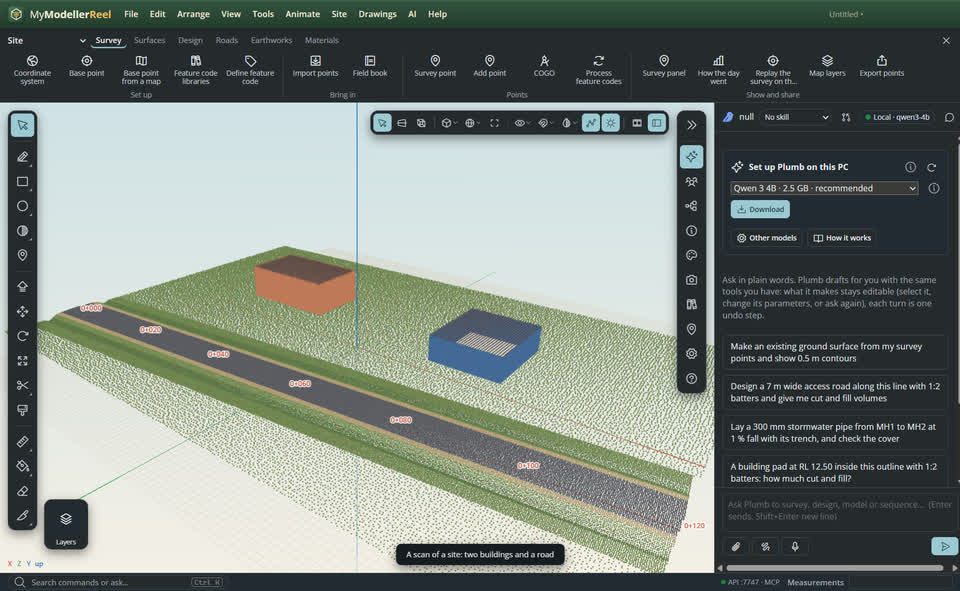
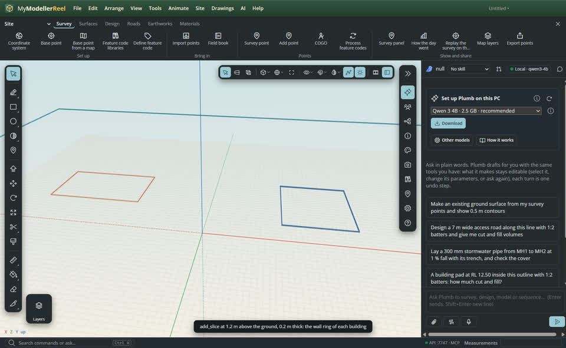
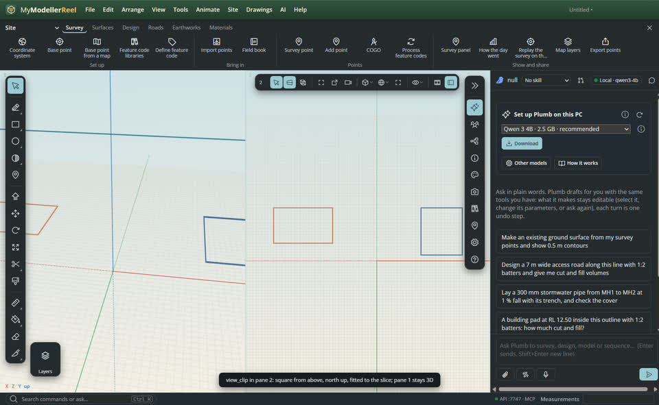
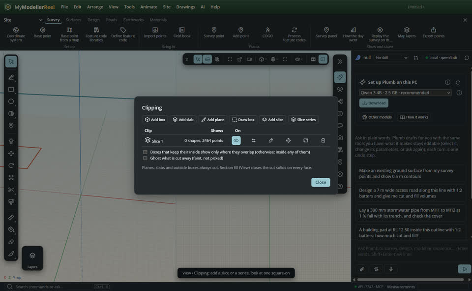
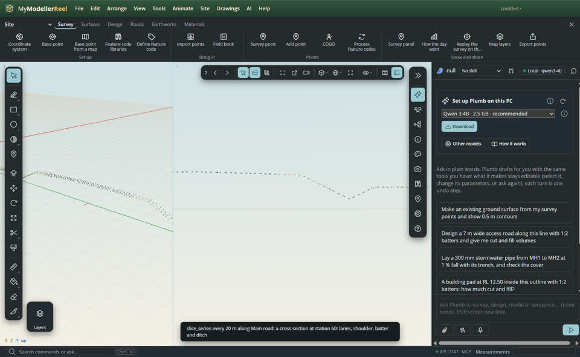
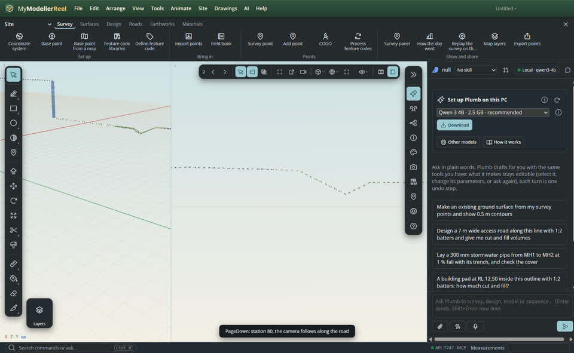

# Slice a scan: plans at a level, cross-sections at stations, square-on views

Most drafting over a scan starts from a slice: a thin band of points 1.2 m above the ground shows the walls of every building as a plan, a band across the road at a station shows its cross-section. A **slice** is a slab clip (see [clip volumes](howto:clip-volumes)) placed for you: at an elevation, along a line, across or along an alignment, or parallel to a face. Look at it square-on in a second view, step through a series of them with **PageDown** and **PageUp**, read how many points it holds, keep its points to draw over, save it with a scene, and sweep it through the scan in a video.


## In the app

1. Import the scan ([Import point cloud](do:import_point_cloud)). Here: a site with two buildings and a road on a low embankment, with its alignment, *Main road*.
   
2. [Add a slice](do:add_slice) at an elevation, `z: 1.2` with `above: ground` and a thickness of 0.2 m: only that band of the scan shows, and the wall ring of each building stands out. The reply gives its statistics: the points inside, their bounds, the density and a histogram of their heights.
   
3. [Look at it square-on](do:view_clip) in pane 2: a parallel view square to the slab, fitted to its points, north up for a level slice. Pane 1 keeps the 3D view. In that view, drawing tools snap to the slice's points.
   
4. [View › Clipping…](action:sectionPlanes) has **Add slice** and **Slice series**, and a square-on button on every slab.
   
5. A [slice series](do:slice_series) across the alignment every 20 m makes a cross-section at each station, shown one at a time. Zoom pane 2 onto the road: the lanes, the shoulder, the batter and the ditch.
   
6. **PageDown** (or the arrows in the pane's bar, or [step_slice](do:step_slice)) shows the next station; the camera moves along the road and keeps your zoom. **PageUp** goes back.
   

## Kinds of slices

- **At an elevation**: `at: 'elevation'`, `z` (project elevation), or `z` above the ground with `above: 'ground'` (a ground surface when there is one, else the scan's low points around the site).
- **Along a line**: `at: 'line'`, two points (or survey point names, or a curve and its `segment`): an upright slab containing the line, for the elevation of a wall or a retaining wall.
- **Across an alignment**: `at: 'station'`, `alignment`, `station`; `along: true` puts the slab along the alignment at that station instead.
- **Through a face**: `at: 'face'`, `id`, `face`, `offset`: parallel to a face of a model, moved along its normal.

A series runs at elevations (floor levels: `from: 0, to: 12, step: 3`) or stations (`from: 0, to: 200, step: 20`).

## Ask Plumb

> Give me a 20 cm slice 1.2 m above the ground and show it from above in the second view.

> Cut a cross-section of Main road every 20 m and show me station 120.

> How many points are in that slice, and how dense is it?

> Make a video sweeping a slice up through the buildings.

## From a script, the HTTP API or MCP

```js
await api.add_slice({ at: 'elevation', z: 1.2, above: 'ground', thickness: 0.2 });       // → { clip, stats }
await api.view_clip({ name: 'Slice 1', pane: 2 });                                        // square-on, pane 1 stays 3D
await api.slice_points({ name: 'Slice 1', max: 300 });                                    // [[u, v], …] in the slab's frame
await api.slice_points({ name: 'Slice 1', store: true });                                 // a point set to snap to
await api.add_slice({ at: 'station', alignment: 'Main road', station: 120, thickness: 0.5 });
await api.slice_series({ at: 'station', alignment: 'Main road', from: 0, to: 120, step: 20 });
await api.step_slice({ by: 1 });                                                          // PageDown
await api.add_scene({ name: 'Level 1 slice', pane: 2 });                                  // keeps the slice that cuts
await api.animate_section({ clip: 'Slice 1', start: 0, end: 4 });                         // sweep it along its normal
await api.render_video({ path: 'C:/out/sweep.mp4', from: 0, to: 4 });
```

Every slice command returns the statistics (count, bounds in the slab's frame, density in points per m², and a height histogram for a level slice): read those rather than asking for the points.

## Related

- [See only part of the model: clip boxes, slabs and planes](howto:clip-volumes)
- [Model over a scan and make the ground from it](howto:scan-to-ground)
- [Work with several views](howto:multiple-views)
