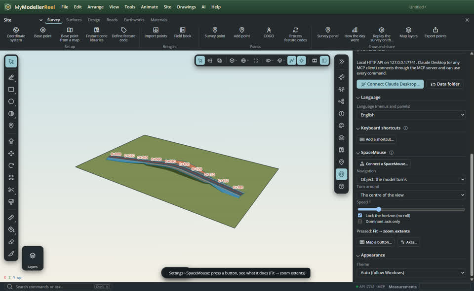
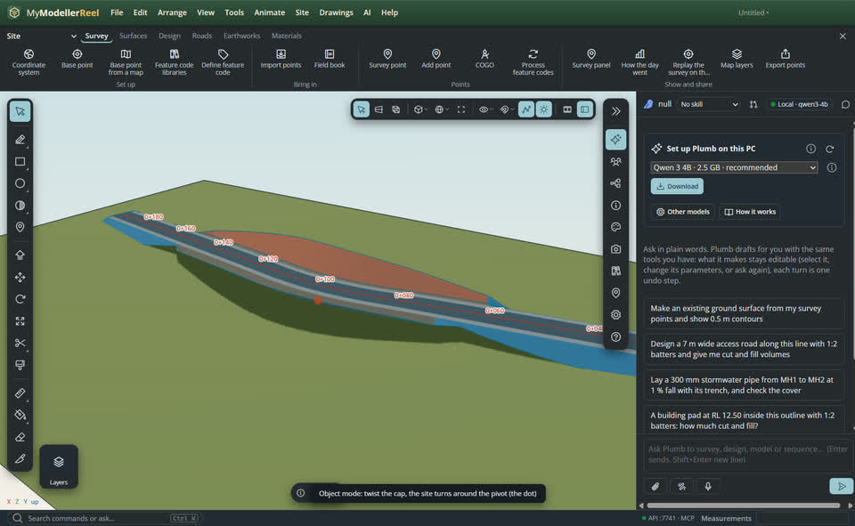
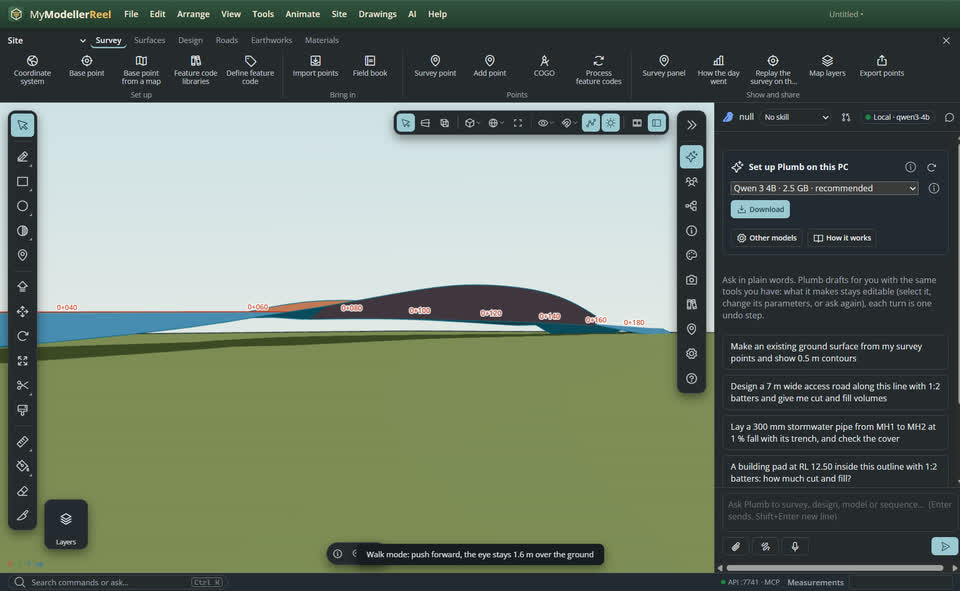

# Navigate with a 3Dconnexion SpaceMouse

A SpaceMouse gives six axes at once in your other hand: pan, zoom, tilt, spin and roll, while the mouse keeps
drawing. Plug it in and move the cap: the view under the mouse cursor moves. Compact, Wireless, Pro, Enterprise,
SpaceNavigator, SpaceExplorer and SpacePilot Pro all work, with the 3Dconnexion driver (3DxWare) installed or not.

## In the app

1. Plug the SpaceMouse in (or its receiver). The app finds it by itself, and finds it again after you unplug and
   replug it. If it does not, open [SpaceMouse settings](action:spacemouse) and press **Connect a SpaceMouse…**.
2. Choose how it moves in **Settings › SpaceMouse**:
   - **Object**: the model turns around a pivot (the centre of the view, the point under the cursor, or the selection;
     a small dot shows it while you move).
   - **Fly**: the eye moves through the scene, good inside a scan.
   - **Walk**: you move at eye height (1.6 m) and the ground follows under you, without roll.
   - **2D**: pan and zoom only, for top views, road profiles and cross-sections.
   
3. Move the cap. Push it a little for fine moves, further for fast ones; the speed follows the distance to what you
   look at, so it feels the same on a whole site and on a kerb detail. Let go and it stops at once.
   
   
4. With several views ([set_layout](do:set_layout)), the one under the mouse cursor moves, detached windows too.

**Speed**, **Lock the horizon** (no roll) and **Dominant axis only** (just the strongest push) are in the same card;
**Axes…** sets the sensitivity, invert and on / off of each axis (tx ty tz rx ry rz), the dead zone and the response
curve (quadratic: small pushes are finer).

### Buttons

Press a button and the card shows its name and what it does. The defaults:

| Button | Does |
| --- | --- |
| Menu | the command palette |
| Fit | [zoom_extents](do:zoom_extents) |
| T, F, R, L, B, Bk, Iso | [set_view](do:set_view) top, front, right, left, bottom, back, iso |
| Rotate | rotations on / off |
| Pan/Zoom | the next navigation mode |
| Dominant, +, − | dominant axis, faster, slower |
| Esc, Ctrl, Shift, Alt | those keys, held with the button |
| 1 … 12 | yours to choose |

**Map a button…** gives any button a menu action, a tool, a command with its arguments (a saved scene, x-ray on, a
view), or `sm:clip`: hold it and the puck moves and turns the selected clip box; let go and it is one undo step. Your
mapping is kept in the app settings, so it is there after a restart.

## Ask Plumb

> Set my SpaceMouse to fly mode, a bit slower, and turn around the point under the cursor.

> Make SpaceMouse button 1 turn x-ray on, and button 2 hold to move the clip box.

## From a script, the HTTP API or MCP

```js
await api.list_input_devices({});
await api.set_spacemouse({ mode: 'walk', speed: 0.8, dead_zone: 0.08, invert: { rz: true }, lock_horizon: true });
await api.set_spacemouse({ mode: 'object', pivot: 'selection', dominant: false, curve: 'quadratic' });
await api.map_spacemouse_button({ button: '1', command: 'set_style', args: { xray: true } });
await api.map_spacemouse_button({ button: '2', action: 'sm:clip' });
await api.map_spacemouse_button({ button: 'Fit', action: 'none' });
```

## Good to know

- **With 3DxWare installed**, the app reads the device directly and 3DxWare may also send the buttons as keystrokes.
  Open 3DxWare's properties while MyModellerReel is in front, and for this application set each button to
  *Application controlled* (or clear it), so a press is not counted twice. Leave the axes as they are: 3DxWare does
  not take them from the app.
- Without a SpaceMouse nothing changes and nothing is logged.
- A clip box needs clip volumes (`add_clip`); without them `sm:clip` says so.
