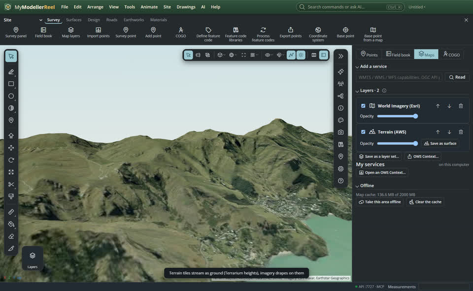
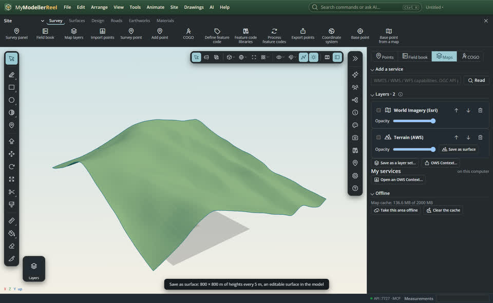
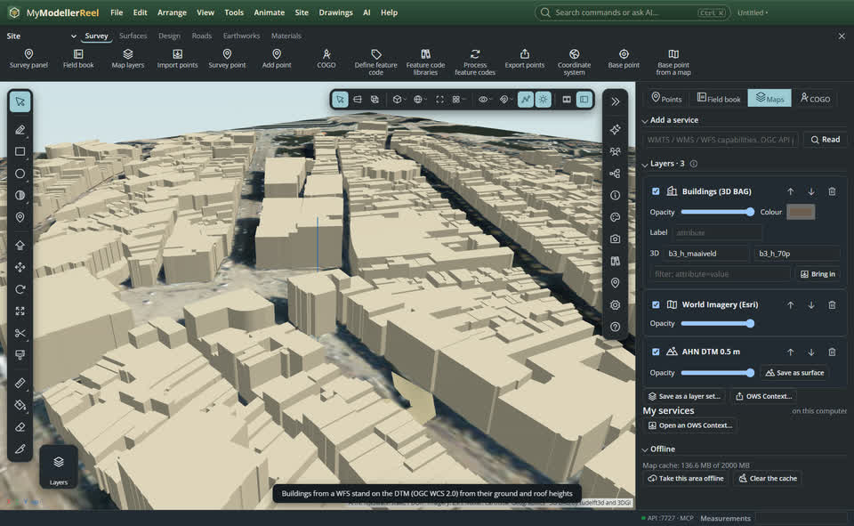

# Stream terrain and buildings from web services, and keep them as surfaces and solids

Elevation services (a DTM or DSM) and building footprints stream under the model as you move, like map layers: nothing is downloaded first. Imagery drapes on the terrain. When you need to work with the ground, save an area as a surface you can edit; bring buildings in as solids with their attributes.


## In the app

1. Place the model on Earth (a coordinate system and a base point), then open [Map layers](action:mapLayers).
2. **Terrain**: paste an elevation service and **Read**:
   - an OGC **WCS 2.0** coverage, like a national DTM or DSM: its coverages are heights already;
   - or tiles that hold heights: pick what they hold under **Holds**: Terrarium (the free AWS terrain tiles, `https://s3.amazonaws.com/elevation-tiles-prod/terrarium/{z}/{x}/{y}.png`), Terrain-RGB, or GeoTIFF.

   The ground streams in, shaded; any map or imagery layer drapes on it, and feature layers follow it.
   
3. **Save as surface** (on the terrain layer) samples the heights around the view into a surface in the model. Edit it like any surface: sculpt, stamp a pad, compare it with a design for cut and fill.
   
4. **Buildings**: add a feature layer of building footprints (WFS or OGC API Features). Under **3D**, give the attribute with the base height and the one with the roof height (or a height in metres): the footprints stand up as blocks on the terrain.
   
5. **Bring in** puts the buildings around the view into the model as prisms, one per footprint, named and carrying their attributes. They stay editable: change a height, push / pull a face.

## Ask Plumb

> Stream the terrain here from the AWS terrain tiles, drape the imagery on it, and save 400 m around the site as a surface at a 2 m spacing.

> Show the buildings from this WFS in 3D using their ground and roof heights, and bring in the ones within 100 m.

## From a script, the HTTP API or MCP

```js
await api.add_map_layer({ url: 'https://example.com/ahn/wcs?SERVICE=WCS&REQUEST=GetCapabilities', layer: 'dtm_05m', name: 'DTM' });
await api.add_map_layer({ url: 'https://s3.amazonaws.com/elevation-tiles-prod/terrarium/{z}/{x}/{y}.png', elevation: 'terrarium', max_zoom: 15, name: 'Terrain' });
await api.elevation_to_surface({ layer: 'DTM', radius: 300, spacing: 1, name: 'Existing ground' });
await api.add_map_layer({ url: 'https://example.com/wfs?SERVICE=WFS&REQUEST=GetCapabilities', layer: 'buildings', name: 'Buildings', style: { extrude: { base: 'ground_height', top: 'roof_height' } } });
await api.import_features({ layer: 'Buildings', radius: 100 });
```

## Related

- [Web map and feature layers](howto:web-map-layers)
- [Read the terrain](howto:read-the-terrain)
- [Cut and fill for a pad](howto:cut-and-fill-for-a-pad)
