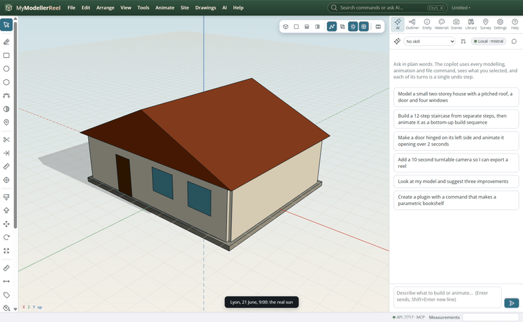
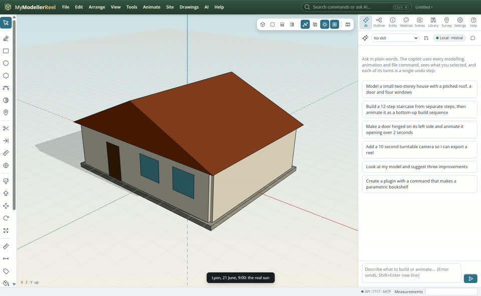
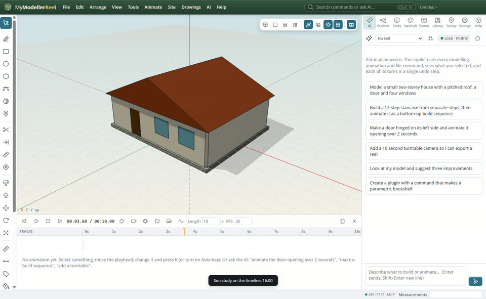
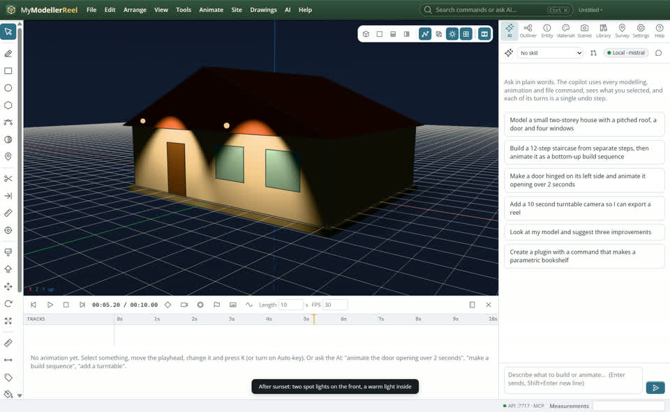

# A sun study and night lighting

You want to show where shadows fall through a day at the real site, or the building lit up at night.




## In the app

1. **View › Geolocation…** [Geolocation](action:geolocation): latitude, longitude, time zone, true north.
2. **View › Sun at a date and time…** [Sun](action:sunTime): the real sun for that moment; shadows follow.
   
3. **View › Sun study on the timeline…** [Sun study](action:sunStudy): the clock runs over the day; render it with **Animate › Render video**.
   
4. After sunset it is night. **Tools › Lights**: [point](action:lightPoint), [spot](action:lightSpot) or [area](action:lightArea) lights; animate their colour or opacity to switch them on.
   

## Ask the copilot

> The site is in Lyon. Make a sun study of 21 June from 6 am to 10 pm over 8 seconds, then light the entrance with two warm spot lights for a night view.

The copilot runs the same commands as the steps above; with **AI › Propose AI changes for review** on, you accept or reject its changes first.

## From a script, the HTTP API or MCP

```js
await api.set_geolocation({ latitude: 45.76, longitude: 4.84, utc_offset: 2, place: 'Lyon' });
await api.animate_sun({ date: '2026-06-21', from: '06:00', to: '22:00', start: 0, end: 8 });
await api.render_video({ path: 'C:/out/sun-study.mp4' });
await api.set_sun_time({ date: '2026-12-21', time: '19:00' });
await api.create_light({ kind: 'spot', position: [-1, 3, 5], target: [-1, 0, 4], color: '#ffd9a0' });
```

## Good to know

- north_angle turns true north when the model's −z is not north.
- The sun position is good to about a hundredth of a degree (no refraction): fine for shadow studies.

## Related

- [Present a design](howto:present-a-design)
- [Make a construction sequence video](howto:construction-sequence-video)
