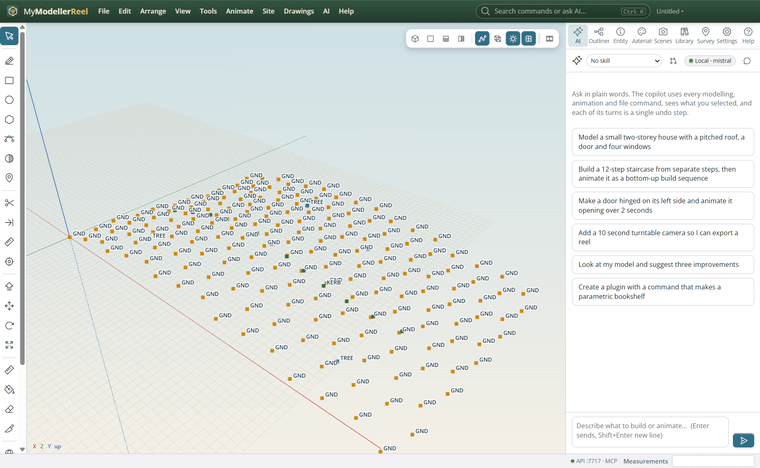
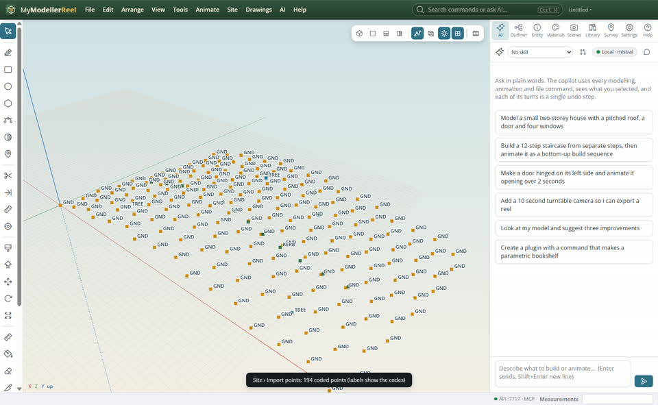
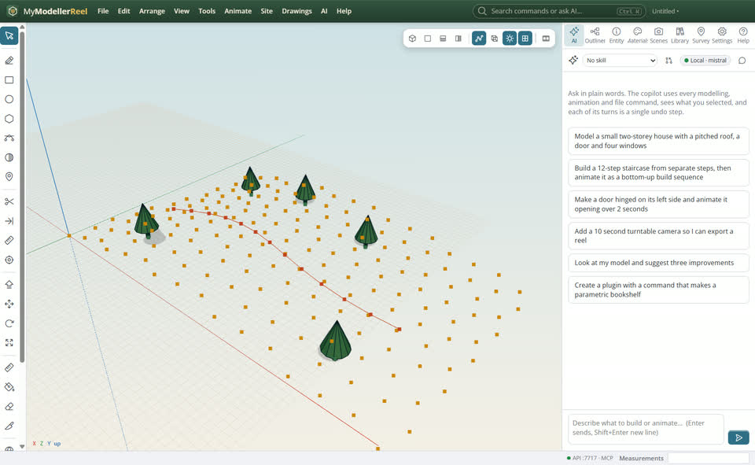
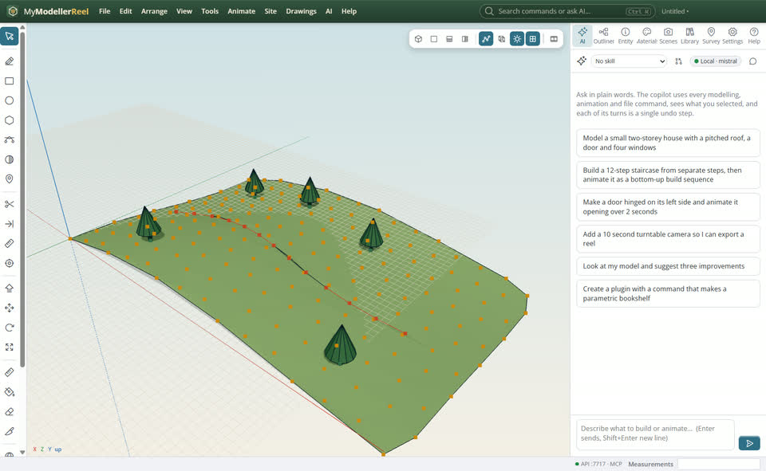
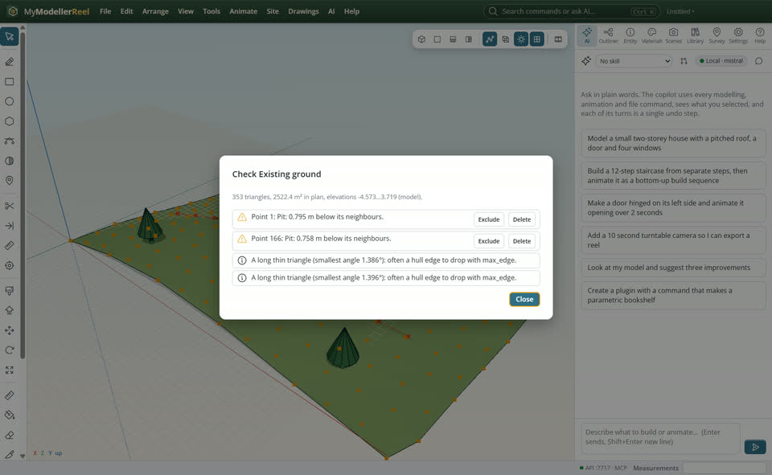

# Turn survey points into a surface

You have surveyed points (a CSV or text file with number, northing, easting, elevation and code) and want a ground surface that follows the kerbs and stays live.



## In the app

1. **Site › Import points** [Import points](action:importPoints): pick the file, then what each column holds ([Import a points file](howto:import-survey-points)). The first point sets the base point, so big coordinates stay exact.
   
2. **Site › Feature code…** tells the app what codes mean: KERB joins into a breakline, TREE places a tree. **Site › Process codes** applies them.
   
3. **Site › Create surface (TIN)…** [Create surface](action:surface): a triangulated surface that honours the breaklines. Move a point and it rebuilds.
   
4. **Site › Check surface** [Check surface](action:checkSurface) flags spikes, pits, duplicates and thin triangles, with the points to fix.
   

## Ask Plumb

> Import C:\survey\site.csv (PNEZD), make KERB a breakline and TREE a tree, then build the existing ground surface and check it.

Plumb runs the same commands as the steps above; with **AI › Propose AI changes for review** on, you accept or reject its changes first.

## From a script, the HTTP API or MCP

```js
await api.import_points({ path: 'C:/survey/site.csv', format: 'PNEZD' });
await api.define_feature_code({ code: 'KERB', line: true, breakline: true, color: '#c8553d' });
await api.process_codes({});
// the kerb back 0.15 m right and up, the gutter 0.3 m left and 0.05 m down: they follow KERB and shape the surface
await api.set_line_offsets({ id: 'KERB', offsets: [{ h: 0.15, v: 0.15, name: 'Back of kerb' }, { h: -0.3, v: -0.05, name: 'Gutter' }] });
const s = await api.create_surface({ name: 'Existing ground' });
await api.check_surface({ id: s.id });
```

## Good to know

- The Survey tab lists every point; edit northings, eastings, elevations and codes in place.
- Coding in the field: with the [Survey point](tool:point) tool, each click opens a small code card. Type a code or pick one (your recent codes come first, then the library's, each saying what it places) and press Enter; Esc places nothing. Click an existing point to change its code. A feature code can also place a component from your model (`object: { type: 'component', component: 'Lamp' }`).
- Offsets on a line: select a breakline or line and, in its card, **Add offset** for each parallel line you need, H metres right (+) or left (−) of its direction and V metres up (+) or down (−): a kerb back, a gutter, a ditch bottom. They are worked out from the line's points, so moving a point moves them, and a breakline's offsets are breaklines of its surfaces too (untick **In surface** to leave one out).
- LandXML points and surfaces come in with **File › Import** too.

## Related

- [Work out cut and fill for a building pad](howto:cut-and-fill-for-a-pad)
- [Bring in a LandXML, IFC or DXF file](howto:bring-in-landxml-ifc-dxf)
