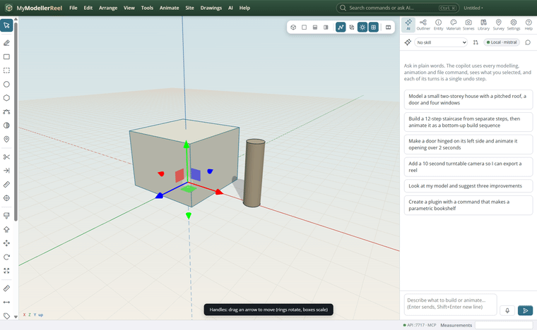
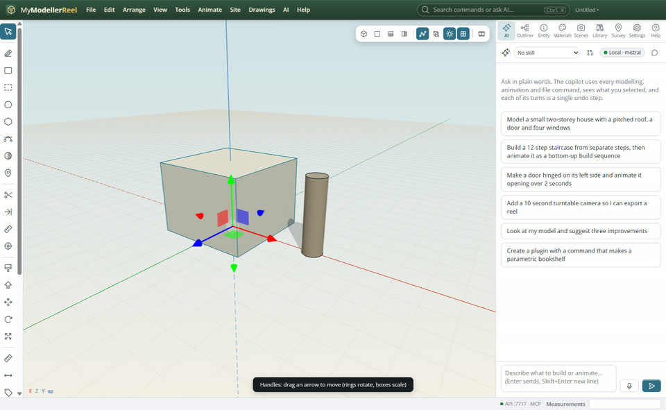
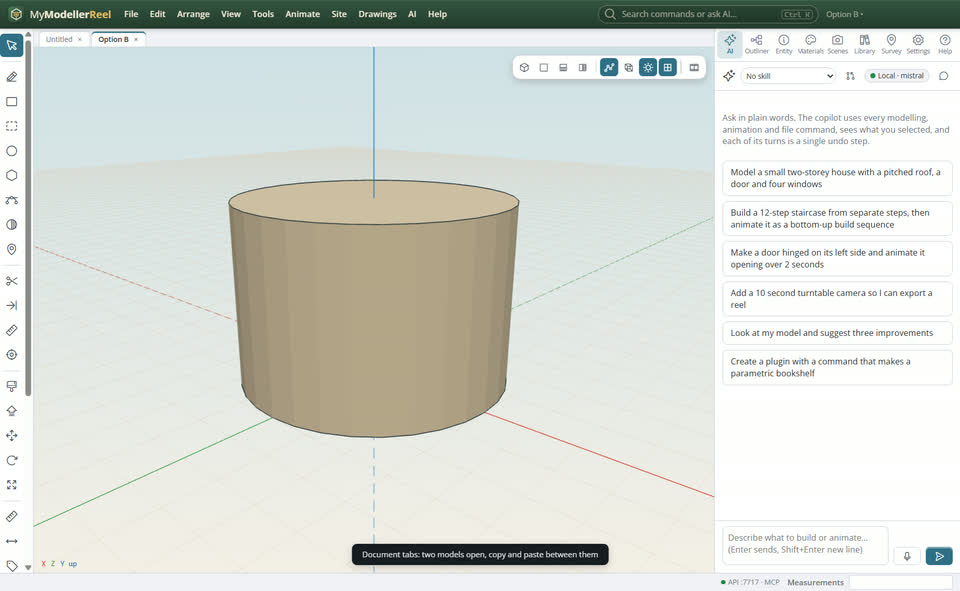
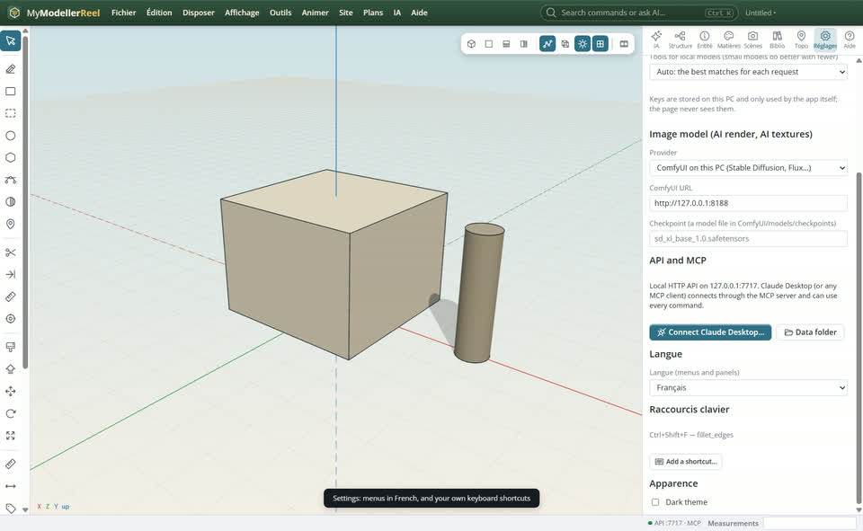

# Work your way: handles, document tabs, walking, shortcuts, voice and French

You want to move things by dragging handles, keep two models open, walk through the design, use your own keys, talk to Plumb, or have the menus in French.



## In the app

1. Select a shape, **Arrange › [Handles: move](action:gizmoMove)** (or rotate, scale): drag an arrow, a ring or a box; the change is one undo step. On a touch screen, two fingers orbit and zoom.
   
2. **File › [New document tab](action:newTab)**: several models open at once; copy in one tab, paste in another.
   
3. **Settings**: the language of the menus and panels (English, French) and your own keyboard shortcuts for any menu action, tool or command.
   
4. The [Walk](tool:walk) tool: arrows or WASD to walk at eye height, drag to look. Hold **Ctrl+M** (or the microphone in the AI panel) to speak to Plumb.

## Ask Plumb

> Open a new tab called Option B, and give me Ctrl+Shift+F for fillet.

## From a script, the HTTP API or MCP

```js
await api.set_gizmo({ mode: 'move' });
await api.new_document({ name: 'Option B' });
await api.switch_document({ name: '1' });
await api.set_shortcut({ key: 'Ctrl+Shift+F', action: 'fillet_edges' });
await api.set_language({ lang: 'fr' });
await api.walk_to({ position: [0, 0, 8], look_at: [0, 1.5, 0] });
await api.transcribe_audio({ path: 'C:/notes/idea.wav' });
```

## Good to know

- Speech to text runs on this PC with MyVoiceReel's engine (`myvoicereel-cli` on the PATH); nothing is sent online.
- The French covers menus, panels and the toolbar; messages from commands stay in English for now.

## Related

- [Model a shape with push / pull, then copy it as a component](howto:push-pull-and-components)
