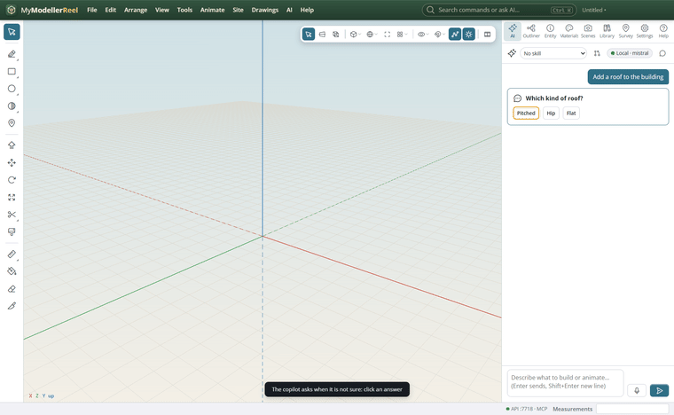
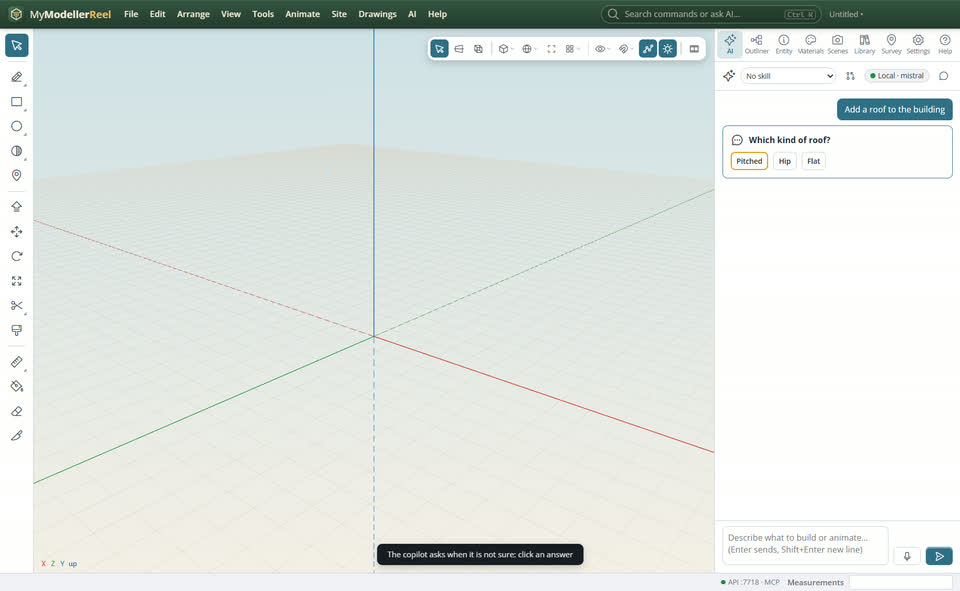
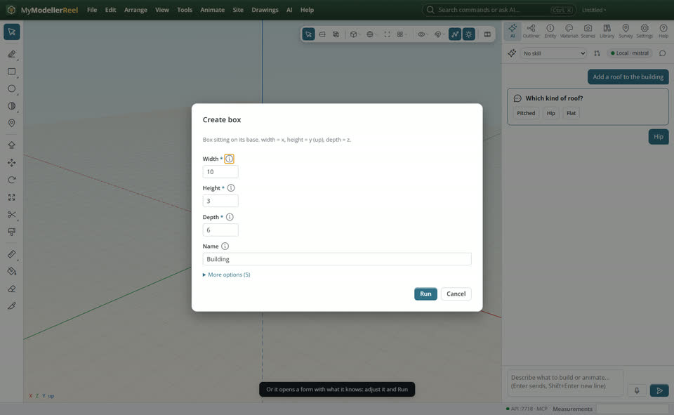
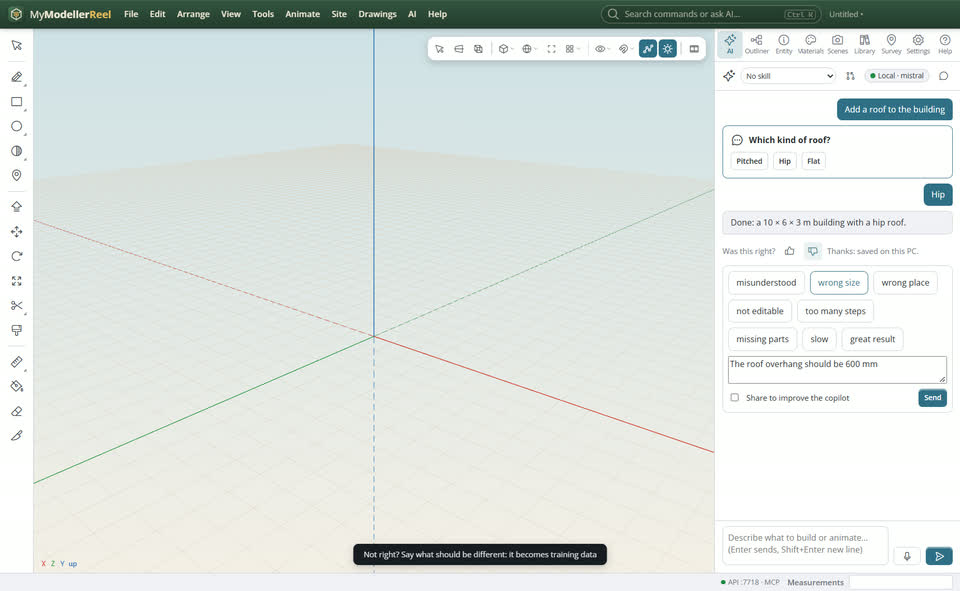
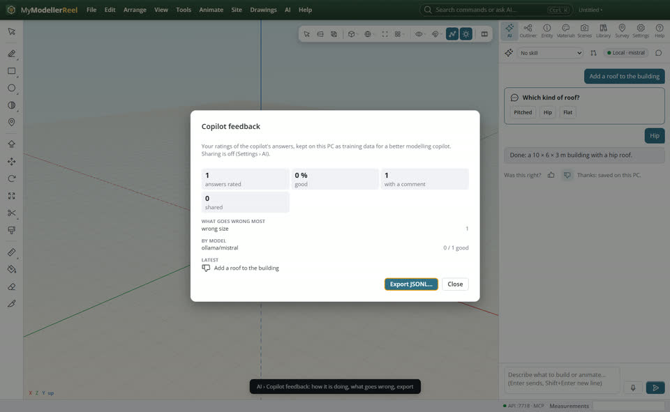

# Work with the copilot: answer its questions, fill its forms, rate its answers

The copilot works with you, not around you. When it is not sure, it asks. When you would rather set values or click places yourself, it brings up the form or the pick for you. Your verdict on each answer is kept as training data, so it can become a better modelling and drafting copilot.



## In the app

1. Ask in the [AI panel](action:aiPanel). If your request is ambiguous ("add a roof"), the copilot asks in the chat: click an answer, or type your own. It carries on with what you chose.
   
2. When you say you want to set the values yourself, it opens the command's form with what it knows filled in. Adjust it, pick points or objects in the view, then **Run**. It can also ask you to click a point or an object in the view, or open the Entity panel on what it made.
   
3. Under every answer: **Was this right?** A thumb saves your verdict at once. Then pick what went wrong (misunderstood, wrong size, wrong place, not editable…) and say what should be different, and click **Send**.
   
4. [Copilot feedback](action:aiFeedback) (AI menu) shows how it is doing: answers rated, the share of good ones, what goes wrong most, per model. **Export JSONL** writes the records as a training file.
   

## What is kept, and where

- Each rated answer is one record: your request, every command the copilot ran with its result, its answer, the model before and after (without PDF or image bytes), the AI model's name and your verdict.
- Records stay on this PC (in the app's data folder, `feedback`).
- **Share my copilot feedback to improve it** (Settings › AI, or the box under a rating) uploads rated records to the MyStudioReel suite under your account. It is off until you turn it on.

## Ask the copilot

> Add a roof to the building, and ask me which kind first.

## From a script, the HTTP API or MCP

```js
await api.rate_ai_turn({ rating: 'bad', tags: ['wrong size'], comment: 'The overhang should be 600 mm' });
await api.list_ai_feedback();                 // rated, good_rate, top_tags, by_model, recent
await api.export_ai_feedback({ path: 'C:/data/copilot-feedback.jsonl' });
await api.share_ai_feedback({ on: true });
// the copilot's own tools: each waits for the person at the app
await api.ask_user({ question: 'Which kind of roof?', choices: ['Pitched', 'Hip', 'Flat'] });
await api.show_form({ command: 'design_trench', values: { depth: 1.2 } });
await api.pick_in_view({ what: 'point', count: 2, hint: 'Click the two ends of the trench' });
```

## Related

- [First steps with the copilot](howto:first-steps-with-the-copilot)
- [Ask the copilot to build or change something](howto:ask-the-copilot)
