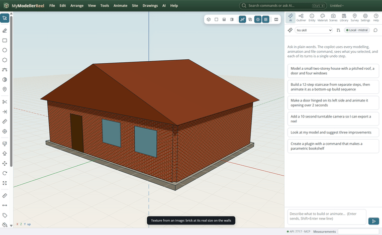
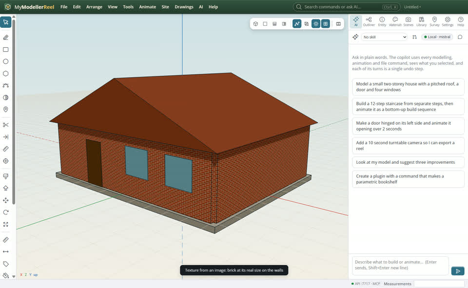
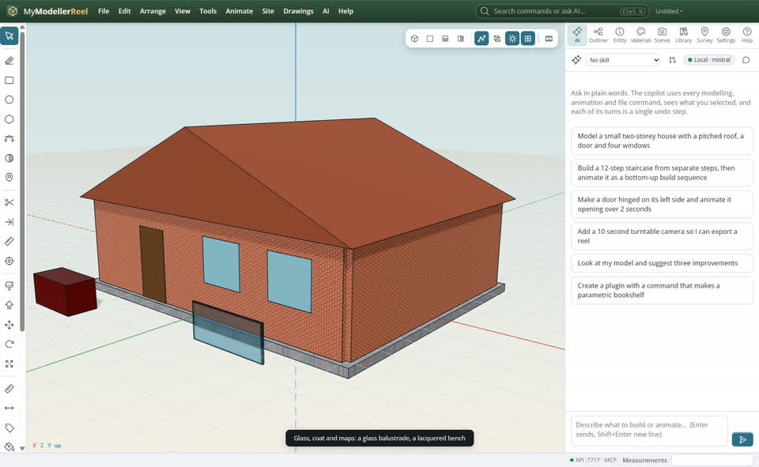

# Textures, glass and AI materials

You want real materials on the model: bricks at the right size, a glass balustrade, a glossy car, or a material described in words.



## In the app

1. Select the walls, **Tools › Texture from an image…** [Texture](action:texture): a PNG or JPG, at its real size (one tile = size in m).
   
2. **Tools › Texture size and projection…** [Projection](action:textureEdit): box (each face from its side), planar, cylindrical; size, offset, rotation.
   
3. **Tools › Glass, coat and maps…** [Glass](action:materialMaps): transmission 1 for glass, clear coat for paint, normal / roughness / AO maps.
   
4. **Tools › AI texture from a prompt…** [AI texture](action:aiTexture): the image model in AI settings paints a seamless material and puts it on the selection.

## Ask Plumb

> Put 0.9 × 0.45 m red brick on the walls, make the balustrade clear glass, and give the roof a dark slate texture from the image model.

Plumb runs the same commands as the steps above; with **AI › Propose AI changes for review** on, you accept or reject its changes first.

## From a script, the HTTP API or MCP

```js
await api.set_texture({ ids: ['North wall', 'South wall'], path: 'C:/tex/brick.png', size: [0.9, 0.45] });
await api.set_material_maps({ ids: ['Balustrade'], transmission: 1, ior: 1.5 });
await api.set_material({ ids: ['Balustrade'], roughness: 0.05 });
await api.generate_texture({ prompt: 'dark slate roof tiles', size: 1.2, ids: ['Roof'] });
```

## Good to know

- Images are kept out of the document and saved inside the .glb file with it.
- Textures follow the shape (they are in its own coordinates): move or rotate it and they move with it.
- AI textures need an image model: ComfyUI on this PC or an OpenAI-compatible images API (Settings › Image model).

## Related

- [Present a design](howto:present-a-design)
