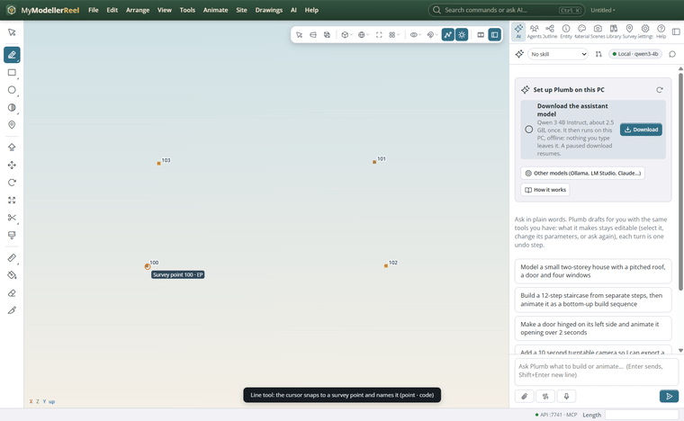
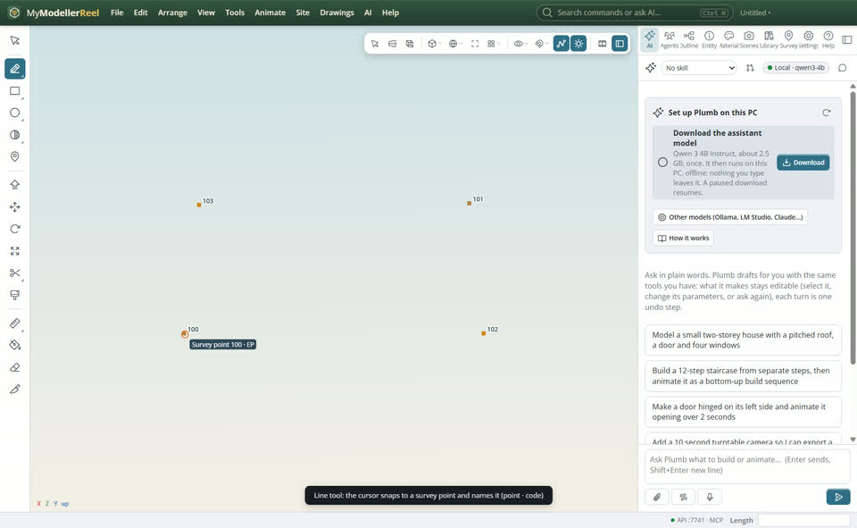
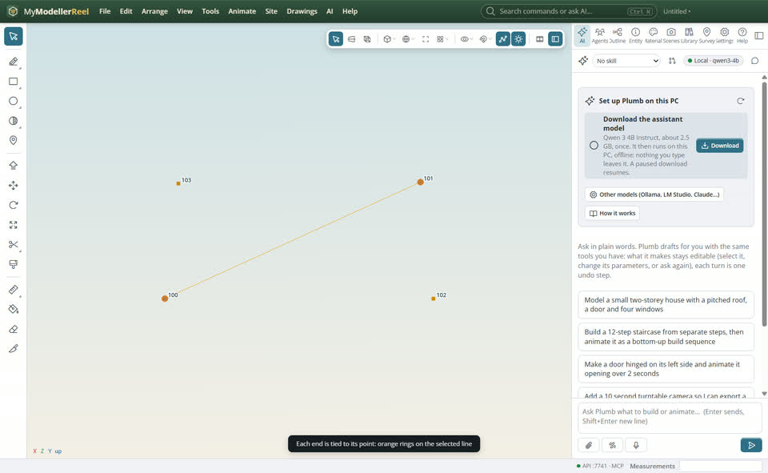
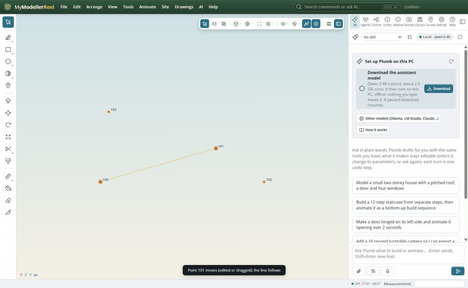

# Draw lines on survey points that follow them

You draw a kerb line, a breakline or a fence through survey points, and later a point is corrected, edited or comes in again from the field. Lines snapped to survey points are tied to them: when a point moves, the line moves with it, and a surface built with that line as a breakline rebuilds.



## In the app

1. Pick [Line](tool:line) (or [Path](tool:curve)) and move over a survey point: the cursor snaps to it and the label names it, with its code (`Survey point 100 · EP`). A survey point wins over a line end at the same place.
   
2. Click: that vertex is tied to the point. Finish the line as usual (Enter, Esc or a double-click).
3. Select the line: its tied vertices show orange rings.
   
4. Move the point ([Move](tool:move) with the point selected, or change its coordinates with [edit_points](do:edit_points)): the line follows. Anything that changes a point moves its tied vertices, an import that updates points in place included. While you drag a point with Move, the tied line is drawn in orange where it will go.
   
5. Dragging a curve point grip (with [Select](tool:select)) onto a survey point ties it too; dragging a tied vertex off its point unties it.
6. To snap without tying, untick **Tie lines to survey points** in the snap menu (or [set_snaps](do:set_snaps) with `tie: false`). Untick **Survey points** to stop snapping to them.

## Ask Plumb

> Tie the first point of Kerb to survey point 100 and the last to 101, then list the ties.

## From a script, the HTTP API or MCP

```js
await api.create_curve({ points: [[0, 0, 0], [5, 0.5, -10]], name: 'Kerb', ties: [{ vertex: 0, point: '100' }, { vertex: 1, point: '101' }] });
await api.tie_vertex({ id: 'Kerb', vertex: 1, point: '102' });   // the vertex goes onto the point
await api.list_ties({ id: 'Kerb' });                              // [{ vertex, point, point_name, code }]
await api.edit_points({ points: ['101'], e: 9, n: 4 });           // the tied vertex follows
await api.untie_vertex({ id: 'Kerb', vertex: 0 });                // or without vertex: all of them
await api.set_snaps({ tie: false });                              // snap to points without tying
```

## Good to know

- Deleting a point unties its vertex and leaves it where it was.
- Moving the whole line without its points unties the moved vertices; select the line and its points together to move them as one.
- Ties are saved with the model and undo with every change. Copy and paste keeps them only when the points are copied too.
- Rounded paths (`r 5` in the Path tool) are not tied: rounding adds points between the ones you clicked.
- Feature-coded linework (from codes like `KERB`) is already made from its points and moves with them without ties.

## Related

- [Turn survey points into a surface](howto:survey-points-to-surface)
- [Edit a surface by hand](howto:edit-a-surface-by-hand)
