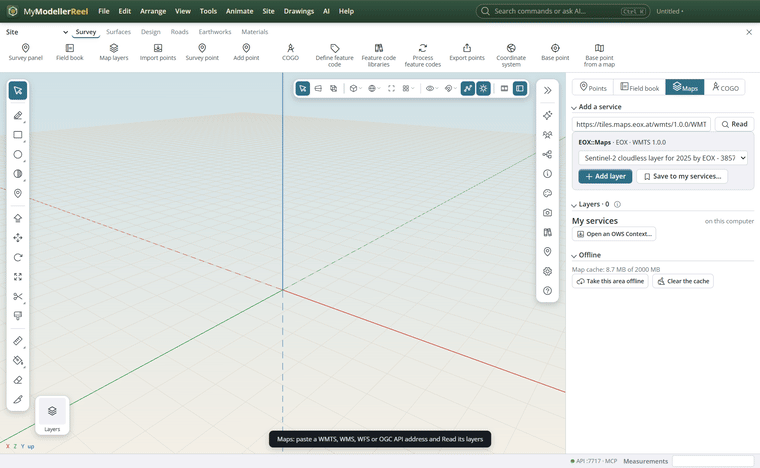
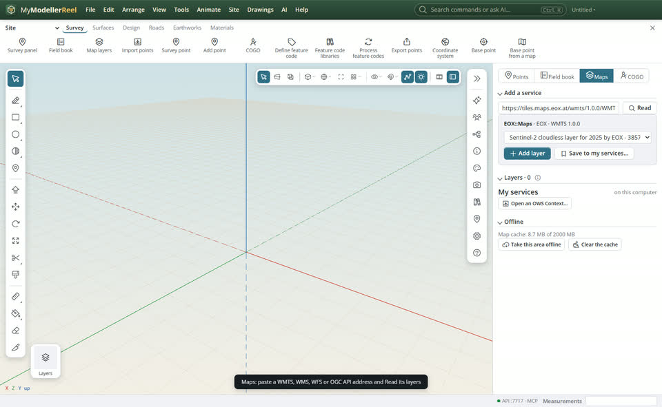
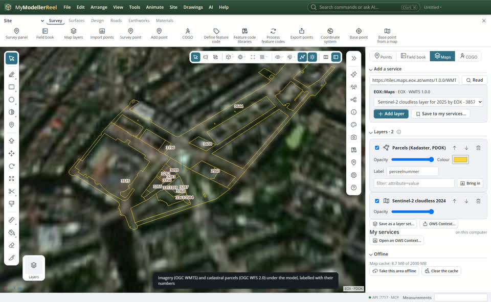

# Web map and feature layers: WMTS, WMS, WFS and OGC API

Put aerial photos, cadastre, zoning or utilities under the model from any OGC service. Map layers stream as you move; feature layers keep their attributes, so you can ask which parcels a road crosses or bring them into the model. Your services and layer sets are saved with your account and follow you to any computer.



## In the app

1. Place the model on Earth first: a coordinate system and a base point ([Place on a map](action:mapPick)). A Trimble job brings its own.
2. Open [Map layers](action:mapLayers) (Survey tab › Maps). Paste a service address: a WMTS or WMS capabilities URL, a WFS 2.0 address, an OGC API landing page, or an XYZ template with `{z}/{x}/{y}`. Click **Read**, pick a layer, **Add layer**.
   
3. Layers draw top first in the list: tick to show or hide, drag the opacity, move them up and down. Feature layers take a colour, a label attribute and a filter (`zone='R1'`).
   
4. **Bring in** puts the features around the view into the model as points, lines and outlines with their attributes, on a layer.
5. **Save to my services…** keeps a service with your account; an API key you give stays in Windows Credential Manager on this computer. **Save as a layer set…** keeps the whole list ("NZ basemap + cadastre") to add to any design.
6. **Take this area offline** downloads the tiles and features around the view, so the layers still show without a network.

## Standards

WMTS 1.0 (Web Mercator tile matrix sets), OGC API - Tiles, WMS 1.3, WFS 2.0 with GeoJSON output, OGC API - Features (Parts 1 to 3, CQL2 filters), OWS Context to save a layer set, SLD / SE for styles, GeoPackage to export features. The full list of what is implemented: [docs/standards/ogc.md](https://github.com/GclinTrimble/MyModellerReel/blob/main/docs/standards/ogc.md).

## Ask Plumb

> Add the parcels from this WFS and tell me which parcels the access road crosses.

> Put my "NZ basemap + cadastre" layer set on this design.

## From a script, the HTTP API or MCP

```js
await api.list_service_layers({ url: 'https://example.com/wmts/1.0.0/WMTSCapabilities.xml' });
await api.add_map_layer({ url: 'https://example.com/wmts/1.0.0/WMTSCapabilities.xml', layer: 'aerial', opacity: 0.8 });
await api.add_map_layer({ url: 'https://example.com/wfs?SERVICE=WFS&REQUEST=GetCapabilities', layer: 'parcels', name: 'Parcels' });
await api.query_service_features({ layer: 'Parcels', touching: 'Access Road centreline' });
await api.import_features({ layer: 'Parcels', radius: 300 });
await api.save_map_service({ name: 'Council GIS', url: 'https://example.com/wfs', key: '…', key_query: 'api_key' });
await api.save_layer_set({ name: 'NZ basemap + cadastre' });
await api.cache_map_area({ radius: 500, max_zoom: 18 });
await api.export_map_context({ path: 'C:/jobs/site-maps.json' });
await api.export_geopackage({ path: 'C:/jobs/site.gpkg' });
```

## Related

- [Place the model on a map](howto:place-on-a-map)
- [Bring in field and GIS data](howto:bring-in-field-and-gis-data)
- [Fix field mistakes in a survey](howto:edit-survey-measurements)
