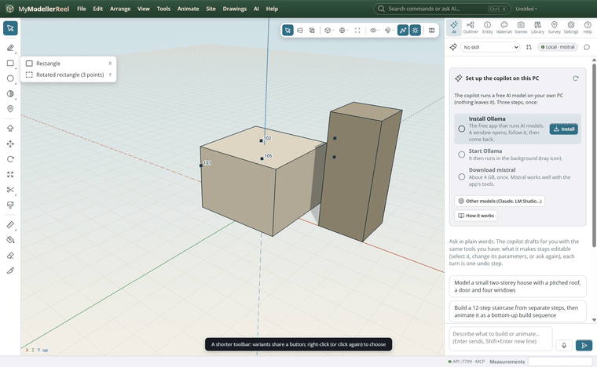
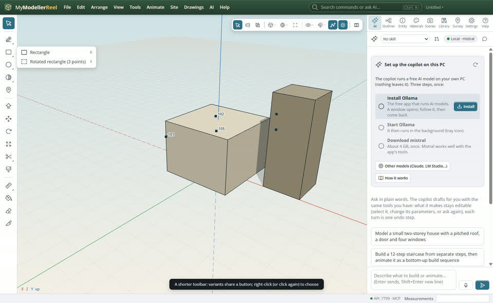
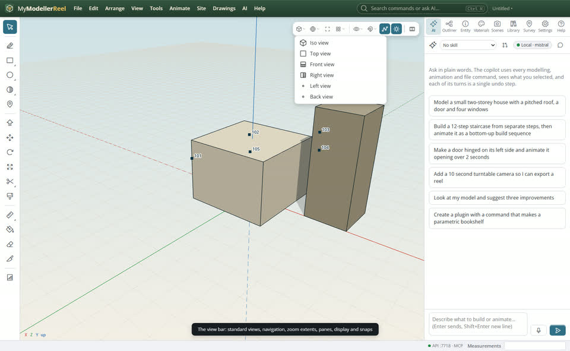
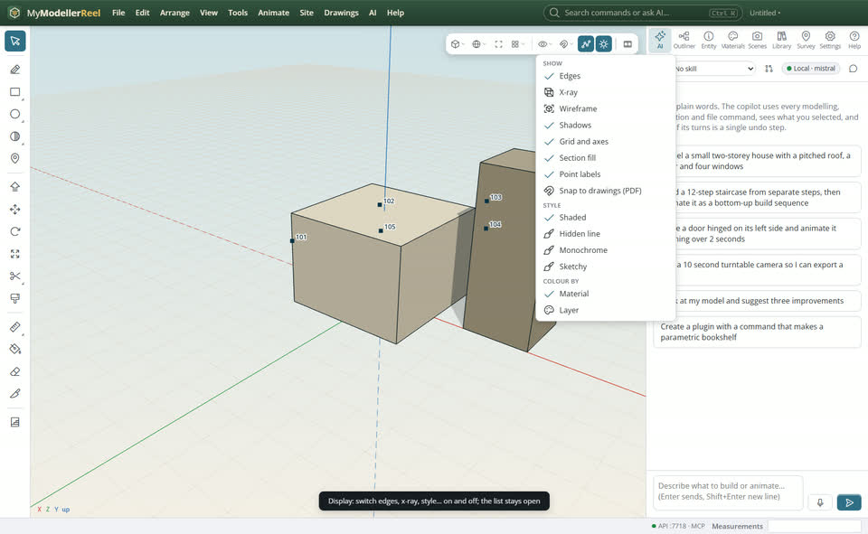
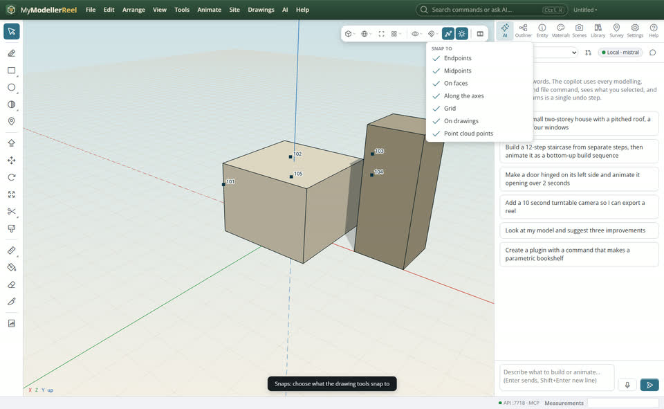
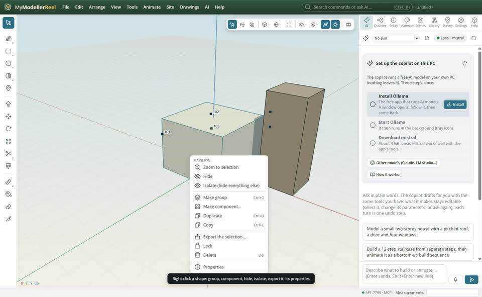
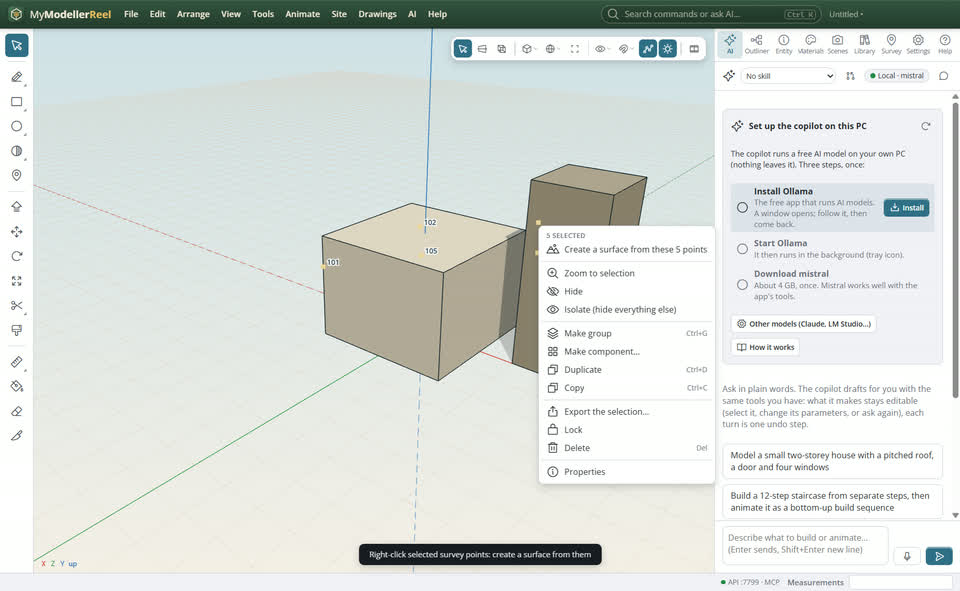
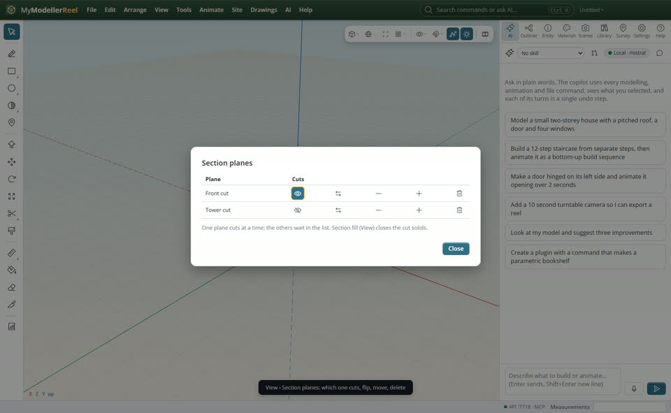
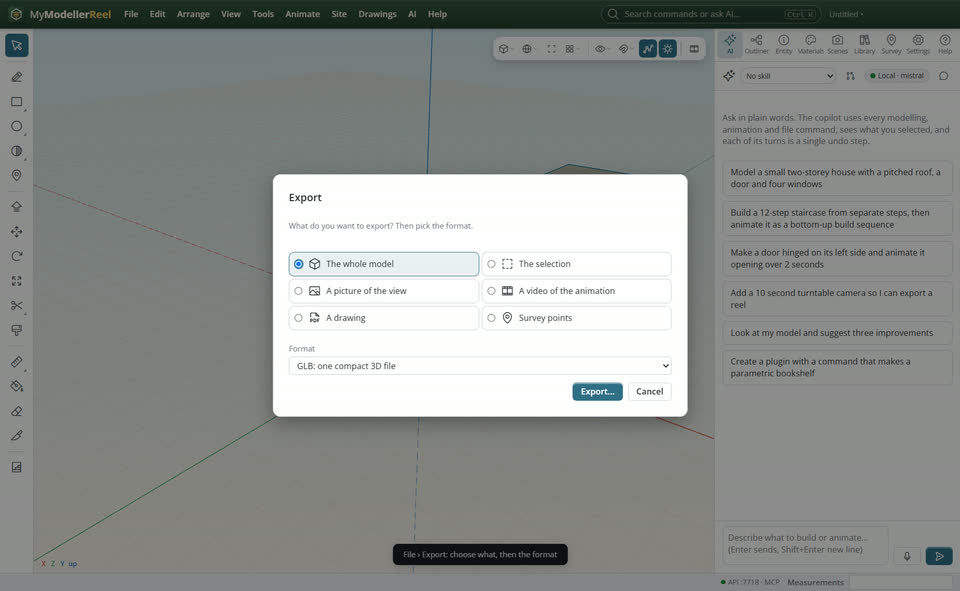
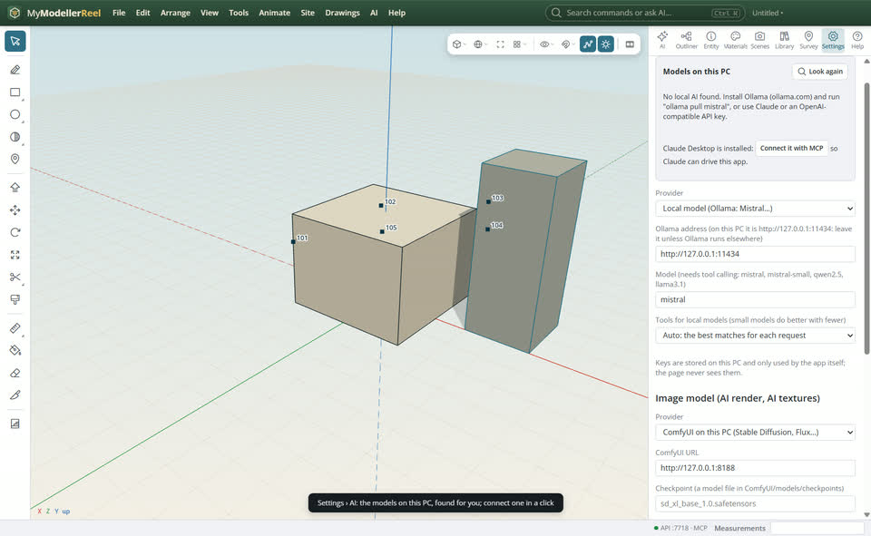

# Find your tools fast: the toolbar, the view bar, right-click, snaps and export

You want the tool you need without scrolling or digging through menus: draw, move around the model, choose what you snap to, act on what you clicked, cut sections, export, and connect Plumb to a model on this PC.



## In the app

1. **The side toolbar** has one button per kind of tool; the variants share it (rectangle and rotated rectangle, circle and polygon, arc and curve, trim and extend, tape, dimension and label). Right-click a button with a corner mark, or click it again, to choose a variant. The [Line](tool:line) tool now keeps open lines: Enter, Esc or a double-click ends the line; closing it on the first point still makes a face.
   
2. **The view bar** (top right) holds the standard views and the navigation tools (orbit, pan, zoom window, walk) as drop-downs, zoom extents, the number of panes, the display toggles and the snaps.
   
3. **Display** switches edges, x-ray, wireframe, shadows, grid, point labels, the style and the colouring; the list stays open while you switch several things. Toggles in the View menu stay open too.
   
4. **Snaps** chooses what the drawing tools snap to: endpoints, midpoints, faces, the axes, the grid, drawings, point clouds. While drawing, right-click for **Next click snaps only to…** one kind.
   
5. **Right-click** a shape for what you can do to it: group, make a component, hide, isolate, export the selection, lock, delete, its properties. Right-click empty space for paste, views and section planes. Dragging with the right button still pans.
   
6. Select survey points and right-click: **Create a surface from these points**.
   
7. **View › [Section planes…](action:sectionPlanes)**: every plane you made with the [Section Plane](tool:section) tool, which one cuts, flip, move, delete.
   
8. **File › [Export…](action:exportAll)** (Ctrl+E): choose what (the model, the selection, a picture, a video, a drawing, survey points), then the format.
   
9. **Settings › AI › Models on this PC** finds Ollama, LM Studio, llama.cpp, vLLM, Jan and GPT4All running here, and models downloaded from Hugging Face; **Use** connects one. If Claude Desktop is installed, connect it with MCP.
   

Selecting with a box: drag left to right to take what is fully inside (solid box), right to left to take what the box touches (dashed box). The [Scale](tool:scale) tool shows handles on the shape you click; the [Eraser](tool:eraser) also removes lines, dimensions and labels. With the [Survey point](tool:point) tool, type `E, N, Z` in the value box to place a point exactly, or `#name` to rename the last one.

## Ask Plumb

> Turn off grid and midpoint snapping, then find the AI models on this PC and use the Mistral one.

## From a script, the HTTP API or MCP

```js
await api.set_snaps({ midpoint: false, grid: false });
await api.section({ normal: [0, 0, -1], point: [0, 0, 0.5], name: 'Front cut' });
await api.set_section_plane({ name: 'Front cut', flip: true, offset: 0.5 });
await api.list_section_planes();
await api.delete_section_plane({ name: 'Front cut' });
const found = await api.detect_local_models();   // servers, their models, Hugging Face downloads
await api.use_ai_model({ provider: 'ollama', model: 'mistral' });
await api.create_surface({ points: ['101', '102', '103', '104'], name: 'Ground' });
```

## Good to know

- Snapping to the nearest point along an edge is not there yet; endpoints and midpoints are.
- Only one section plane cuts at a time; the others wait in the list.
- A model downloaded from Hugging Face needs a server (Ollama, LM Studio…) to run it before Plumb can use it.

## Related

- [See the model from several sides at once: split, resize and detach views](howto:multiple-views)
- [Work your way: handles, document tabs, walking, shortcuts, voice and French](howto:tabs-handles-walk-and-language)
