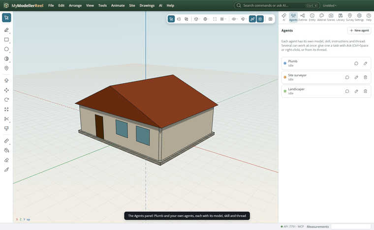
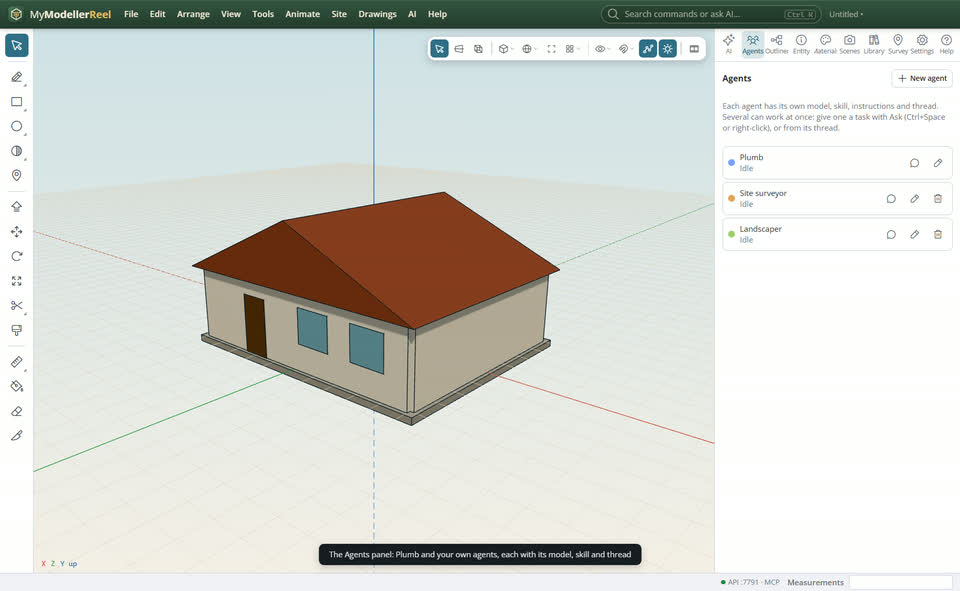
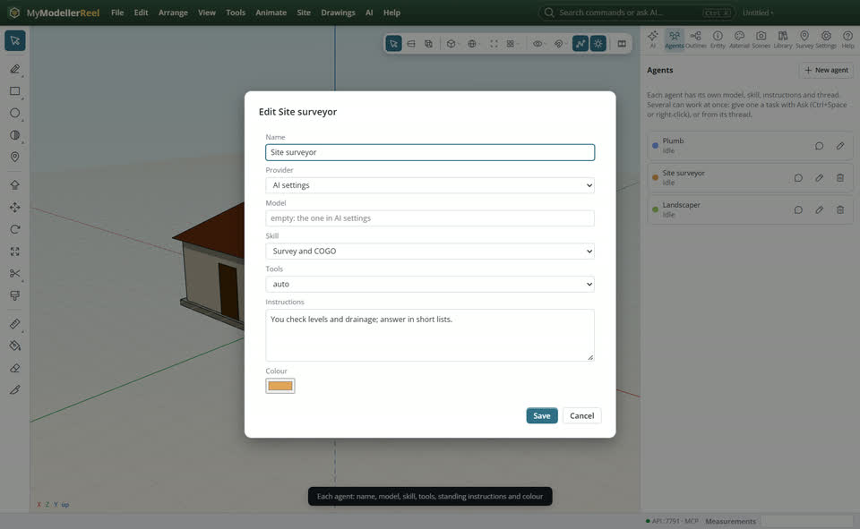
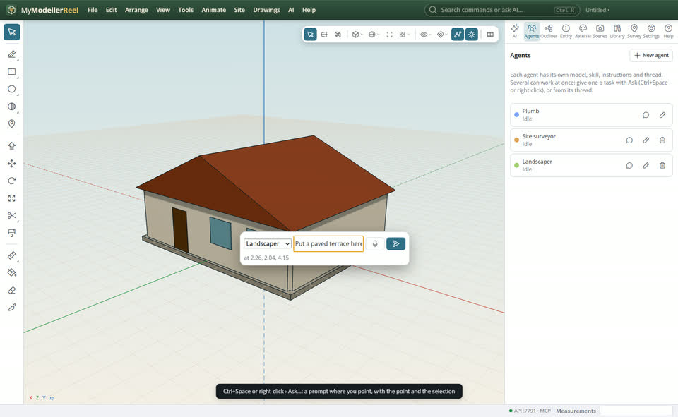

# Work with several agents at once, and ask one anywhere

Plumb, the copilot, is one agent. You can add more: each has its own model, skill, standing instructions, colour and chat thread, and several can work on the same model at the same time. Ask any of them right where you point, by keyboard or by voice.



## In the app

1. Open the [Agents panel](action:agents). Plumb is always there. **New agent** adds one: a name, a model (empty uses the one in AI settings), a skill, a tool set, standing instructions ("You check levels and drainage; answer in short lists") and a colour.
   
   
2. Give tasks to several agents: open one's thread (the speech bubble) and type, or [Ask here](action:askHere). An agent that is busy queues the task and starts it when it is free. The panel shows who is working, with **Stop** and **Retry**.
3. Press Ctrl+Space over the view, or right-click and choose **Ask…**: a small prompt opens at the pointer. It sends the point under the pointer and the selection with your words. Pick the agent, type or hold the microphone to talk, and press Enter. The answer shows as a message and stays in that agent's thread.
   
4. Agents working at the same time share one undo step: Ctrl+Z takes back everything they did together. When one agent tries to change something another agent is working on, that change waits under **Held changes** in the panel: **Apply** it (one undo step) or **Drop** it.

## Ask the copilot

> Make an agent called Site surveyor with the survey skill that checks levels and drainage, then ask it to check the pad.

## From a script, the HTTP API or MCP

```js
await api.save_agent({ name: 'Site surveyor', skill: 'survey', instructions: 'You check levels and drainage.' });
await api.ask_agent({ agent: 'Site surveyor', text: 'Check the falls around the house', point: [4, 0, 2] });
await api.ask_agent({ text: 'Add a garden shed behind the house' }); // Plumb, at the same time
const { agents, held } = await api.list_agents();
if (held.length) await api.held_change({ n: held[0].n, action: 'apply' });
```

## Good to know

- Each agent's thread keeps its own conversation. The agent menu at the top of the AI panel switches between threads.
- Commands run one at a time even when agents work at once, so no agent sees another's change half made.
- The journal records which agent ran each command.

## Related

- [Ask the copilot to build or change something](howto:ask-the-copilot)
- [First steps with the copilot](howto:first-steps-with-the-copilot)
